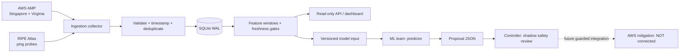

# AdaptiveNet

**Two-region resilience research: collect measurements → build trustworthy features → predict → review actions.**

Singapore is `region-a` (`ap-southeast-1`); Northern Virginia is `region-b` (`us-east-1`). The real workloads run on AWS EC2, while collection and the current ingestion dashboard run locally. Our experiment compares **internal-only** versus **internal + RIPE Atlas** decisions.

> **Verified checkpoint — 14 October 2026:** Both regions produced fresh AWS and RIPE Atlas data, with 3 reporting probes in Singapore and 5 in Virginia; the **combined and internal-only model inputs were ready**. HTTP catalog p95 remained unavailable without usable Prometheus histogram data. **No trained ML model or automatic AWS mitigation exists.** These are past results, not a guarantee of current uptime.

## 1. Find the right component

```text
adaptivenet/
├── apps/
│   ├── demo-web/                # Public-facing Next.js catalogue (local UI, :3001)
│   └── dashboard/               # Next.js local lab/control UI (:3000)
├── services/adaptivenet/
│   ├── demo_api.py              # Python catalogue API (also used by local Docker lab)
│   ├── ingestion/               # REAL telemetry → SQLite → features → model input
│   │   ├── sources.py           # AWS Prometheus + RIPE Atlas API clients
│   │   ├── models.py            # Validated observations and deduplication IDs
│   │   ├── store.py             # SQLite WAL, time-indexed events and snapshots
│   │   ├── features.py          # Rolling windows, EWMA, missing/stale checks
│   │   ├── handoff.py           # Model input + conservative demonstration baseline
│   │   ├── decisions.py         # Shadow-only proposal safety review
│   │   ├── config.py            # Region/workspace/measurement configuration
│   │   ├── cli.py               # Implementation of once/watch/serve/export
│   │   └── api.py               # Minimal read-only telemetry dashboard (:8766)
│   ├── controller/              # LOCAL demo controller/route policy (not AWS actuation)
│   ├── gateway.py               # Local-only simulated routing
│   ├── control_api.py           # Local operator API; not the ingestion API
│   ├── experiment_runner.py     # Local fault-injection endpoints
│   └── collectors/             # Earlier standalone metric collectors
├── ml/predictor.py              # ML TEAM: replace rule example with model inference
├── packages/contracts/src/     # TypeScript interfaces for model/features
├── scripts/                    # Short entry-point CLIs; see commands below
├── infra/terraform/            # REAL AWS IaC; never apply without review
├── infra/helm/demo/            # Future Kubernetes workload chart (EKS not deployed)
├── tests/                      # Offline regression suite
├── docs/TEAM_HANDOFF.md         # Model → proposal → controller field contracts
├── docs/DATA_DICTIONARY.md      # Feature units and meanings
└── README.md                   # The project's only README
```

**Two different demonstrations:** `apps/demo-web` + `apps/dashboard` use the **local simulated gateway**. The current **real AWS telemetry viewer** is `http://127.0.0.1:8766`, implemented in `ingestion/api.py`. It is deliberately simple; neither Next.js UI is yet wired to this feature API. Deployed EC2 workloads and Prometheus configuration are defined in `infra/terraform/environments/demo-cloud` and `infra/terraform/modules/public-demo`.

## 2. Data flow and actual metrics



| Input source | Raw observations fetched | Features available to ML |
|---|---|---|
| AWS Managed Prometheus — application | `adaptivenet_demo_up`; catalog request counters and duration histogram buckets | Up/down, requests/s, HTTP 5xx/s, error ratio, catalog HTTP p95 (only with usable traffic) |
| AWS Managed Prometheus — node exporter | `node_cpu_seconds_total`, `node_memory_MemAvailable_bytes`, `node_memory_MemTotal_bytes`, `node_load1` | CPU busy %, memory bytes/available %, 1-minute load |
| RIPE Atlas ping probes | Per-probe packet replies, RTT, packet loss, **original** timestamps | External RTT p50/p95, packet loss %, reporting-probe count |
| Feature engine | Indexed historical observations, source quality and region labels | EWMA, robust z-score (when sample count permits), regional deltas, missing masks and provenance |

The `sources.py` collector queries a **fixed list of PromQL expressions** (no arbitrary model-supplied PromQL). Responses become validated `Observation` records. SHA-256-based event IDs prevent repeated RIPE results and repeat polling from being double-counted. `store.py` persists records atomically in SQLite WAL with B-tree indexes. `features.py` buckets by `(region, metric)` using dictionaries and computes bounded time windows with a `deque`.

**Safety rules:** `null` means **unknown**, never zero. A zero request rate can be real; an unavailable p95 is not automatically a problem. Missing or expired probe readings are **not** outages. AMP samples have a 3-minute freshness threshold (plus a bounded 30-second clock-skew allowance); RIPE signals use a 35-minute freshness limit and require at least three probes. A saved snapshot is also checked again for age before *live* inference.

## 3. CloudFront, EKS, scaling and real AWS mitigation

**Current scope: AWS EC2 + Prometheus + RIPE Atlas telemetry works; CloudFront infrastructure and ingestion code are now included, but a CloudFront distribution has NOT been deployed or verified. No ML-driven AWS traffic shifts or Kubernetes scaling are enabled.** The local lab, Terraform definitions and shadow-controller review are different things. **Infrastructure code is not proof of deployment.** Use the read-only checks below and the actual AWS account/state before claiming a resource is live.

| Capability | Present in the repository | Deployed / operational? | Who completes it |
|---|---|---|---|
| **CloudFront CDN** | Isolated Terraform distribution (SG primary, Virginia failover) and a CloudWatch collector are included | **Not deployed/verified**; metrics are not visible until a distribution ID is configured and live CloudWatch data is available | Infrastructure + ingestion |
| **EKS / Kubernetes** | `infra/terraform/environments/platform/main.tf` and `modules/observability-region/main.tf` can define EKS + a managed node group; `enable_eks=false` and `enable_second_region=false` by default | **Not verified deployed**; current tested workloads are EC2 instances | Infrastructure |
| **Kubernetes app** | `infra/helm/demo/templates/workload.yaml` defines a Deployment + Service with health probes and resource requests/limits | Helm chart exists, but no confirmed EKS release or production ingress/load balancer | Infrastructure + application |
| **Pod autoscaling (HPA)** | No `HorizontalPodAutoscaler` manifest, metrics-server provisioning, KEDA or external-metrics wiring | **Not implemented** | Scaling/controller + infrastructure |
| **Node autoscaling** | An optional EKS node group has `min_size=1`, `desired_size=2`, `max_size=4` | These are **capacity bounds, not a working node autoscaler**; no Karpenter/Cluster Autoscaler integration | Infrastructure + scaling |
| **Route 53 DNS routing** | `infra/terraform/environments/demo-cloud/main.tf` conditionally defines two weighted `A` records (50/50) and `/healthz` checks with `enable_route53=false` | Configuration **disabled by default**; deployed DNS routing not verified | Infrastructure |
| **Real Route 53 mitigation** | No read/write-back adapter to change live weights; `ingestion/decisions.py` always rejects execution | **Not implemented** | Controller |
| **ML-driven scale-out** | `ml/predictor.py` is a rule-based example; `scale_out` is explicitly rejected by the reviewer | **Not implemented** | ML + controller + scaling |

**Where are CloudFront metrics?** In the new collector `services/adaptivenet/ingestion/cloudfront.py`: CloudWatch `AWS/CloudFront` Requests, error rates and bytes in `us-east-1` using `DistributionId` and `Region=Global`. They are **global CDN** metrics, optional and nullable, not regional AMP or RIPE RTT. They appear once the separately deployed distribution is configured in `.env` and has published metrics. `CacheHitRate` and `OriginLatency` need separately enabled additional metrics.

**Routing architecture must be chosen first:** Route 53 weighted DNS records can split *DNS answers* between **regional public endpoints** (EC2 now, regional load balancers if moving to EKS). DNS caches/TTL mean a change is **not an instant, exact per-request 50/50 split**. Putting a **single CloudFront distribution** in front introduces a different origin-routing layer; editing two Route 53 records does **not** automatically change that distribution's origin weights. CloudFront is now the **planned CDN/primary-origin-failover path**; Route 53 weighted DNS is a separate future control mechanism. Agree on the actual traffic path before implementing either mechanism. See [AWS weighted routing](https://docs.aws.amazon.com/Route53/latest/DeveloperGuide/routing-policy-weighted.html).

### CloudFront AWS setup — deliberate and isolated

1. From the AWS owner, confirm account ID, AWS CLI profile, actual regional instance IDs/IPs, and permission to read EC2/CloudFront/CloudWatch. Review cost (CloudFront requests and transfer) and the security limitations above. The Terraform configuration defaults to EC2 instance IDs `i-0039feaedbd2b3266` (SG) and `i-0ea5125bcb2d201ec` (US); **verify these are still the right instances**. Do **not** run in the existing demo-cloud/platform Terraform state.
2. Set up a **separate, private, versioned S3 Terraform state key**, such as `cloudfront/terraform.tfstate`, in the existing approved state bucket. The Terraform module uses an explicit S3 backend so it cannot accidentally deploy using untracked local state. Obtain the reviewed bucket and lock settings from the infra owner.
3. With Terraform 1.13.x and an AWS-authorized profile, from `infra/terraform/environments/cloudfront/`:

```bash
aws sso login --profile adaptivenet-admin
export AWS_PROFILE=adaptivenet-admin
terraform fmt -check
terraform init -backend-config="bucket=YOUR_EXISTING_PRIVATE_STATE_BUCKET" -backend-config="key=cloudfront/terraform.tfstate" -backend-config="region=ap-southeast-1" -backend-config="encrypt=true" -backend-config="use_lockfile=true"
terraform validate
terraform plan -var="aws_account_id=YOUR_ACCOUNT_ID" -out=cf.tfplan
terraform show cf.tfplan
# ONLY after reviewing changes/costs/permissions and confirming this is the expected account:
terraform apply cf.tfplan
terraform output cloudfront_distribution_id
terraform output cloudfront_domain_name
```

The CloudFront stack is globally scoped but uses **AWS us-east-1** for the distribution API/metrics. Apply creates a billed resource and takes time to deploy. If the plan proposes replacing EC2/EKS or destroying anything unexpected, **stop**. The stack's `prevent_destroy` and `retain_on_delete` guards are intentional. A standalone S3 state bucket is **not** created by this module; reuse the existing approved private remote backend. Terraform AWS write permissions and cloudfront:GetDistribution + cloudwatch:GetMetricData read permissions are required for end-to-end verification.

4. From the repository root, set the returned **distribution ID** (not the domain, not an AWS key) and verify:

```bash
python scripts/cloudfront_configure.py --id YOUR_DISTRIBUTION_ID
python scripts/cloudfront_doctor.py
python scripts/cloudfront_probe.py --count 5
python scripts/cloudfront_probe.py --count 5 --run
python scripts/ingestion.py once --profile adaptivenet-admin
python scripts/ingestion.py serve --port 8766
```

Use `--run` only with authorization to generate bounded real traffic. Allow CloudWatch publishing time before diagnosing missing metrics. Restart any previous `watch` and `serve` processes so the new code and `.env` are reloaded. An environment variable named `CLOUDFRONT_DISTRIBUTION_ID` overrides `.env` and may need to be unset. The `cloudfront` field is **global and optional**: if the distribution is unconfigured, the dashboard says `not_configured`; if metrics are missing/stale, they stay `null` and do not falsify AWS/RIPE model readiness.

**macOS HTTPS certificate troubleshooting:** A newly installed python.org Python (especially 3.14) may not have trusted certificate roots configured. If `scripts/cloudfront_probe.py --run` reports `CERTIFICATE_VERIFY_FAILED`, run `python -m pip install --upgrade certifi` and `export SSL_CERT_FILE="$(python -c 'import certifi; print(certifi.where())')"` in the **same Terminal**; retry the probe. Python.org installations also provide `/Applications/Python 3.14/Install Certificates.command` to initialize trust. The probe now combines normal verified trust with certifi when available. **Never turn off TLS verification.** Compare with `curl -fsS https://YOUR_DISTRIBUTION.cloudfront.net/healthz` to distinguish Python CA setup from an origin/application issue. If CloudFront is `Deployed` but `cloudfront_doctor.py` initially reports all six standard metrics missing, send bounded successful test requests first and rerun the doctor after CloudWatch has published observations; standard CloudFront metrics require no additional subscription. Do not substitute zeros for missing metrics.

### CloudFront dashboard metrics, interpretation and follow-on work

| CloudFront metric | Display | Source |
|---|---|---|
| `cloudfront_requests` | Requests per 60-second CloudWatch period | CloudFront `Requests`, `Sum` |
| `cloudfront_4xx_pct` / `cloudfront_5xx_pct` | Error percentage | `4xxErrorRate` / `5xxErrorRate`, `Average` |
| `cloudfront_total_error_pct` | Total error percentage | `TotalErrorRate`, `Average` |
| `cloudfront_bytes_downloaded` / `cloudfront_bytes_uploaded` | Bytes per 60-second period | `BytesDownloaded` / `BytesUploaded`, `Sum` |

**Limits:** Standard CloudFront metrics do **not** include every desired measurement. `CacheHitRate` and `OriginLatency` require additional metrics/charges and are not enabled by this stack. CloudFront metrics are **global aggregate signals**, not per-region origin latency. The current origin failover has fixed SG-primary/US-backup behavior and **does not perform ML-controlled weighted balancing**. The source currently queries one metric point per key; do not use a single metric point as a training history or failover trigger. Use stored snapshots/controlled experiments for training.

**Work required before claiming end-to-end automatic resilience:**

1. **Infrastructure / scaling team:** choose EC2 vs EKS and the entry point (Route 53 directly to healthy regional endpoints, or a separately designed CloudFront arrangement). If choosing EKS, review Terraform state/costs, deploy and secure both clusters, publish an application image, install the Helm workload and regional ingress/load balancers, and verify fail/restart behavior. The existing ECR image publishing workflow is **not an EKS deployment pipeline**.
2. **Scaling team:** implement and test a **baseline autoscaler without ML**: Kubernetes Metrics Server + HPA for pod replicas, plus verified node-capacity scaling (Karpenter/Cluster Autoscaler or reviewed EKS Auto Mode). Define min/max replicas, resource requests, quotas, cooldown/stabilization and load tests. If HPA owns replica count, a future ML controller should adjust a **reviewed HPA target or policy**, rather than race HPA by separately setting replica counts. [AWS HPA guide](https://docs.aws.amazon.com/eks/latest/userguide/horizontal-pod-autoscaler.html).
3. **Data team:** keep the current AMP + RIPE contract; repair/validate optional HTTP p95 histograms; add **pod replicas/availability, scaling events, regional load balancer health** and other EKS signals if deployed. Use the included **CloudFront CloudWatch metrics once a distribution is deployed**, with separately labeled global metrics and explicit missingness. Version and test any changed ML feature contract.
4. **ML team:** train and evaluate `ml/predictor.py` on *labeled, time-split* normal/overload/failure experiments, compare internal-only vs combined features fairly, quantify false alarms and detection delay, and return `adaptivenet.proposal.v1` recommendations. A proposal is not an infrastructure command.
5. **Controller team:** connect an inference runner to `ingestion/decisions.py` in **shadow mode first**. Add repeated-evidence/hysteresis, route ownership, up-to-date destination health/capacity, least-privilege authentication, cooldown, idempotency, max-step limits, operator approval, full audit and verified rollback. **Then**, with a separately reviewed authorization and tested adapters, support bounded Route 53 record-weight changes and/or HPA policy updates. Today's `services/adaptivenet/controller/` and `gateway.py` affect the **local simulator only**; they do not act on AWS. Never call Terraform apply as an automatic mitigation operation.
6. **Experiment / UI team:** compare **no mitigation vs baseline HPA / fixed routing vs ML-guided shadow policy**, then test approved live actions in a disposable environment. Record recovery time, SLO impact, false positives, extra capacity cost, DNS propagation and rollback. The `:8766` dashboard shows **metrics and data readiness**, not currently executed failover.

**Read-only verification by an AWS-authorized teammate** (Mac/Windows terminals; these commands do **not** create infrastructure):

```bash
aws cloudfront list-distributions --profile adaptivenet-admin --query "DistributionList.Items[].{Id:Id,Domain:DomainName}" --output table
aws eks list-clusters --region ap-southeast-1 --profile adaptivenet-admin
aws eks list-clusters --region us-east-1 --profile adaptivenet-admin
```

These checks show what the signed-in account can list. For Route 53, inspect the intended hosted zone and current records with the infrastructure owner, and reconcile with verified remote Terraform state **before** enabling `enable_route53` or `enable_eks`. A `git push`, PR merge, model prediction or dashboard refresh does **not** deploy these resources.

## 4. Quick start: macOS and Windows

**Requirements for offline work:** Python 3.11+, Git. **Extra for live AWS collection:** AWS CLI v2, `awscurl`, valid AWS IAM Identity Center login with permission to query both AMP workspaces. **Optional UI/demo lab:** Node.js + npm or Docker. The private repository requires GitHub access. **Until this handoff is merged into `main`, run `git switch feature/ingestion-ml-handoff` immediately after cloning** (macOS or Windows); skip that command after merge.

### macOS (Terminal)

```bash
git clone https://github.com/Linus-Tay/adaptivenet.git
cd adaptivenet
python3 -m venv .venv
source .venv/bin/activate
python -m pip install -e '.[dev]' awscurl certifi
python -m pytest -q
aws configure sso --profile adaptivenet-admin
aws sso login --profile adaptivenet-admin
export SSL_CERT_FILE="$(python -c 'import certifi; print(certifi.where())')"
python scripts/ingestion.py once --profile adaptivenet-admin
```

### Windows (PowerShell)

```powershell
git clone https://github.com/Linus-Tay/adaptivenet.git
Set-Location .\adaptivenet
py -3 -m venv .venv
$env:Path = "$PWD\.venv\Scripts;$env:Path"
python -m pip install -e ".[dev]" awscurl certifi
python -m pytest -q
aws configure sso --profile adaptivenet-admin
aws sso login --profile adaptivenet-admin
$env:SSL_CERT_FILE = python -c "import certifi; print(certifi.where())"
python scripts/ingestion.py once --profile adaptivenet-admin
```

The PowerShell `Path` command selects the virtual environment without changing execution policy. Repeat it in **each new PowerShell window**. Run `aws configure sso` only once per profile; subsequently use `aws sso login` to refresh expired sessions. Change `adaptivenet-admin` if your team has a different approved profile. **SSO credentials are not RIPE API keys; do not copy anyone else's SSO token or hardcode AWS access keys.** A teammate without AWS access can still run the tests and work on a sanitized exported dataset.

### Run the ingestion viewer (both operating systems)

In **Terminal 1** (your virtual environment must be active):

```bash
python scripts/ingestion.py watch --profile adaptivenet-admin --interval 120
```

In **Terminal 2** (activate the same virtual environment, but AWS login is not required for serving saved data):

```bash
python scripts/ingestion.py serve --port 8766
```

Open **http://127.0.0.1:8766**. The page **only reads existing snapshots**. Only `once` and `watch` collect data. Stop either with Ctrl+C. **Never expose this unauthenticated localhost API to the internet.**

Endpoints: `GET /v1/features/latest`, `GET /v1/features/history?limit=50`, `GET /v1/ingestion/status`.

### Observatory dashboard (new)

The read-only **Network Observatory** is served at **http://127.0.0.1:8766/** directly by `scripts/ingestion.py serve`. It is **not** the Next.js local lab on port 3000 or the CloudFront website. It requires no `npm install`, CDN, image assets, or frontend API key.

It displays:
- **Overview:** model-input readiness, snapshot age (live inference rejects snapshots older than 180 seconds), healthy regions, RIPE probe coverage, and global CloudFront request count.
- **Singapore and Virginia:** RIPE latency/packet loss, CPU, memory, app/HTTP diagnostics, and source freshness.
- **History:** selectable real-time-series charts across up to 120 persisted snapshots; absent measurements remain gaps instead of invented points.
- **CloudFront (global):** requests, 4xx/5xx/total error percentages and transferred bytes from CloudWatch `us-east-1`, when configured and observed.
- **Data quality:** individual source gates, current upstream `no_series` errors, and last poll details.
- **Feature explorer:** searchable and scope-filterable full regional and global feature values, units, and observation ages, with links to all three read-only API endpoints.

**Seeing the old page?** Stop the running `serve` process with Ctrl+C (the HTML is loaded when the Python process starts), pull this branch, and restart `python scripts/ingestion.py serve --port 8766` from the **same repo and SQLite database** as `watch`. Force-reload the browser. Run `python scripts/ingestion.py once --profile adaptivenet-admin` if the data has become stale. Auto-refresh reads saved snapshots every 30 seconds; it does not run ingestion or update AWS.

**CloudFront still blank?** Verify local `.env` has `CLOUDFRONT_DISTRIBUTION_ID`, `python scripts/cloudfront_doctor.py` returns actual CloudWatch points after legitimate requests, then restart `watch` and run one cycle. `Unavailable` always means missing/stale, never 0. The dashboard is intentionally loopback-only and has no authentication; do not expose port 8766 publicly.


## 5. RIPE Atlas stopped, cloned, or replaced measurements

The first measurements, Singapore `222734302` and Virginia `222734303`, are **historical**. Stopping or closing your laptop does not delete their results. Polling old results does not make them fresh. Running/cloning **new recurring measurements uses RIPE credits**, independently of the local dashboard.

When you clone them on [RIPE Atlas](https://atlas.ripe.net/measurements/), confirm each cloned ping still targets the **current public address** of the correct EC2 instance. EC2 public IPs can change after stop/start. Set a bounded end time so probes don't run longer than needed.

In your cloned repository, use this **read-only status check** and then register the **NEW IDs**:

```bash
python scripts/ripe_measurements.py status
python scripts/ripe_measurements.py set --region-a NEW_SG_ID --region-b NEW_US_ID
python scripts/ripe_measurements.py status
python scripts/ingestion.py once --profile adaptivenet-admin
```

Replace `NEW_SG_ID` and `NEW_US_ID` with the actual integer measurement IDs. `set` validates public RIPE metadata/results, changes only `ATLAS_MEASUREMENTS` in the local `.env`, and backs up the old `.env` under ignored `data/config-backups/`. It **does not create or stop measurements or spend RIPE credits**. If a clone has not produced results yet, you can save IDs with `--offline` after verifying them in RIPE's browser, then check status later. Restart any running `watch` process to pick up the new IDs. If `ATLAS_MEASUREMENTS` is also exported in your shell, unset it because shell variables override `.env`.

To create **new** measurements from the command line rather than clone in RIPE's UI, see `scripts/atlas_setup.py --help`; it requires an explicit confirmation, API key and bounded stop time. Never commit a RIPE creation key.


### Measurement IDs versus API keys

| Setting | What it is | Where to update it |
|---|---|---|
| `ATLAS_MEASUREMENTS` | **Public numeric RIPE measurement IDs**, one for each region; needed whenever measurements are cloned/replaced | Local ignored `.env`, preferably via `scripts/ripe_measurements.py set` |
| `ATLAS_API_KEY` | **Secret RIPE creation key**; only needed by `scripts/atlas_setup.py --create` to create credit-consuming measurements | Set temporarily in your **shell environment**, never in tracked source or Git |
| `adaptivenet-admin` | **AWS CLI SSO profile name**, not an API key | Each team member runs `aws configure sso` (once) and `aws sso login` |
| `AMP_SG_WORKSPACE_ID` / `AMP_US_WORKSPACE_ID` | Nonsecret AMP workspace identifiers, not credentials | Local `.env` only if AWS workspaces are changed; read permissions are still required |

**Cloning on the RIPE Atlas website does not require you to rotate or supply an API key to the AdaptiveNet collector.** It only needs the new measurement IDs. Public RIPE result reads also do not require `ATLAS_API_KEY`. The current verified replacement measurements on 14 October 2026 were `region-a=222874954` and `region-b=222874912`; check their **current** state rather than treating them as permanent defaults.

For a cloned measurement, from the repository root:

```bash
python scripts/ripe_measurements.py set --region-a NEW_SG_ID --region-b NEW_US_ID
python scripts/ripe_measurements.py status
python scripts/ingestion.py once --profile adaptivenet-admin
```

Run the same `python` commands in Windows PowerShell. If results still show the old IDs, a shell variable may be overriding `.env`: run `unset ATLAS_MEASUREMENTS` in macOS zsh, or `Remove-Item Env:ATLAS_MEASUREMENTS` in PowerShell if the variable is present, then restart `watch`. **Always run collector and dashboard from the same repository and database.** The status tool's `fresh=true` describes the newest RIPE result; the model also requires **at least three distinct fresh probes with usable RTT per region**.

**Only if creating new measurements via the CLI:** generate or rotate a creation key in your own RIPE Atlas account and supply it as `ATLAS_API_KEY` to `scripts/atlas_setup.py`. For macOS zsh:

```zsh
read -s "ATLAS_API_KEY?RIPE creation key (hidden): "
export ATLAS_API_KEY
echo
python scripts/atlas_setup.py --region-a CURRENT_SG_PUBLIC_IP --region-b CURRENT_US_PUBLIC_IP --duration-hours 6
```

The command above is **dry run**. After reviewing the target IPs, probe count, stop time and credits, add `--create` to the end of the same command if genuinely necessary. Then run `unset ATLAS_API_KEY`. In Windows PowerShell, use `$secret = Read-Host "RIPE creation key" -AsSecureString`, `$env:ATLAS_API_KEY = [System.Net.NetworkCredential]::new("", $secret).Password`, run the dry run/create commands, then `Remove-Item Env:ATLAS_API_KEY`. A shell environment variable is temporary; it is **not** a place for long-term secret storage. Do not print or commit the key.

## 6. When the dashboard shows `Unavailable`

An unavailable value means **missing, stale, or insufficient source data**, not zero. Check these in order from the **same repository root**:

```bash
python scripts/ripe_measurements.py status
python scripts/ingestion_doctor.py --profile adaptivenet-admin
python scripts/amp_metric_doctor.py --profile adaptivenet-admin
python scripts/ingestion.py once --profile adaptivenet-admin
```

| What is unavailable? | Inspect / next step |
|---|---|
| **RIPE RTT / packet loss; 0 probes** | Confirm `ATLAS_MEASUREMENTS` uses the cloned IDs, they target the correct public EC2 IPs, status is Ongoing and 3+ recent probes report RTT. Restart `watch` after changing `.env`. A newly Scheduled measurement may have no samples yet. |
| **HTTP catalog p95 in both regions** | Run `python scripts/catalog_probe.py --run --count 5` to create **bounded real HTTP traffic** (only with experiment approval). After at least two Prometheus scrapes and remote write, inspect `python scripts/amp_metric_doctor.py --profile adaptivenet-admin`. |
| **Doctor: `histogram_raw=no_series`** | Sending more HTTP requests alone may **not** help: verify the deployed latency histogram exporter, `/metrics` exposure and AWS remote-write scraping. The repo's local catalogue API is **not** proof that the EC2 histogram exporter is deployed. |
| **Doctor: `histogram_raw=present`, `http_p95_5m=no_series`** | Check `histogram_filtered`, `catalog_scrapes_5m` and the `le` bucket labels. The 5-minute `rate()` window needs enough recent samples and matching region/project/route labels. |
| **AWS CPU / memory / app health missing** | Refresh AWS SSO login, verify AMP workspace IDs/permissions, and inspect `ingestion_doctor.py`; do not assume AWS is down. |
| **Snapshot never changes** | `serve` is read-only. Run `once` or keep `watch` running, and check both commands use the same `--db` path and current working directory. |

If the collector reports `region-a:http_p95_ms:no_series` or `region-b:http_p95_ms:no_series` but the page says **Model input: READY**, that is valid: HTTP p95 is an **optional** feature. The minimum internal + RIPE readiness gates passed. Do not replace `null` with a fabricated zero. HTTP request duration and external RIPE ICMP RTT measure different things.

**Re-check:** `python scripts/ingestion.py once --profile adaptivenet-admin` and refresh `http://127.0.0.1:8766`. Continue debugging any `no_series` values that matter to your experiment, but do not change Terraform, monitoring agents or live routes based on a blank widget alone.

## 7. ML → controller teammate handoff

After at least one local snapshot exists:

```bash
python scripts/model_handoff.py input --mode internal_only --out data/model-input.json
python scripts/model_handoff.py demo --mode internal_only
python scripts/ingestion.py export --format jsonl --limit 200 --out data/features-v1.jsonl
```

| Owner | Edit here | Contract |
|---|---|---|
| Data/ingestion | `services/adaptivenet/ingestion/{sources,models,store,features}.py` | Raw telemetry → `adaptivenet.features.v1` snapshots |
| ML/model | **`ml/predictor.py`** | Input `adaptivenet.model_input.v1` → proposal `adaptivenet.proposal.v1` |
| Controller | `services/adaptivenet/ingestion/decisions.py` | Validate proposals → `adaptivenet.decision_review.v1` (shadow only) |
| Local routing simulation | `services/adaptivenet/controller/engine.py` + `gateway.py` | Separate simulation; **not** permissioned AWS actions |
| Frontend | `apps/dashboard`, `packages/contracts/src/` | Eventually visualize proposals and outcomes |

`ml/predictor.py` currently delegates to a **conservative rule example**, not a trained classifier and **not yet wired into live inference**. ML teammates should replace its pure `predict(model_input)` function, then connect a reviewed inference runner. Train and evaluate on time-split **labeled experiments**, comparing internal-only versus combined input when RIPE is fresh. Model output is a *proposal*, never an AWS API command.

**Proposals:** `hold`, `investigate`, `shift_traffic`, `scale_out`. The shadow reviewer always returns `approved_for_execution=false` and `executed=false`. A future actuator must independently verify route ownership, destination health, permission, repeated evidence, cooldown, idempotency, rollback and audit history. Nothing here automatically changes AWS routing.

## 8. Optional demo applications (different from ingestion viewer)

For a **local simulated** full demo (requires Docker + a random `LAB_TOKEN` in `.env`):

```bash
test -e .env || cp .env.example .env
docker compose up --build
```

For Windows PowerShell, create the file only when absent: `if (-not (Test-Path .env)) { Copy-Item .env.example .env }`. **Before starting Docker, set a long random `LAB_TOKEN` in `.env`. If `.env` already contains your cloned RIPE IDs, edit it in place—do not overwrite it with `.env.example`.**

This runs `demo-web` at **http://127.0.0.1:3001**, local operator dashboard at **http://127.0.0.1:3000**, control API at `:8000`, and simulated gateway at `:8080`. The Docker demo uses **locally simulated** A/B routing and fault injection; it is not the EC2/RIPE data pipeline. Do not expose local demo ports publicly.

Or, with Node.js and the local Python services already running, `npm ci`, then `npm run dev:demo` and `npm run dev:dashboard` in separate terminals. Their API routes expect the local gateway and control services.

## 9. Experiments, checks, and Git safety

```bash
python -m pytest -q
python scripts/ingestion_doctor.py --profile adaptivenet-admin   # read-only AWS + RIPE
python scripts/amp_metric_doctor.py --profile adaptivenet-admin # read-only AMP details
python scripts/catalog_probe.py --run                       # small real HTTP test traffic
python scripts/check_push_safety.py --staged                # run after git add
```

Run commands in the **repository root** with your virtual environment activated. `data/` (SQLite/features/backups), `.env`, `.venv`, local credentials and Terraform state are **ignored by Git**. Do not use `git add -f` for them. Use feature branches and review `git diff --cached --name-only` before pushing.

**Infrastructure caution:** AWS EC2, managed Prometheus, IAM and CloudWatch already exist, but your clone has only their Terraform definitions—not the live Terraform state. **Never run `terraform apply`, `destroy`, or import state based only on this README.** AWS deployment changes need a separate reviewed plan, verified remote state and cost/permission approval. Neither EKS nor real Route 53 failover is implemented.

**Next research tasks:** collect labeled controlled incidents, train and calibrate the ML model, measure detection/recovery times and false positives, connect a read-only inference runner, then develop an independently guarded reversible actuator. Until then, all decisions remain **shadow-mode**.
