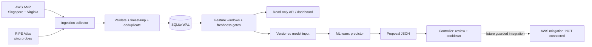

# AdaptiveNet

**Two-region resilience research: collect measurements → build trustworthy features → predict → review actions.**

Singapore is `region-a` (`ap-southeast-1`); Northern Virginia is `region-b` (`us-east-1`). The real workloads run on AWS EC2, while collection and the current ingestion dashboard run locally. Our experiment compares **internal-only** versus **internal + RIPE Atlas** decisions.

> **Verified checkpoint — 14 October 2026:** Both AWS regions produced fresh internal metrics; the internal-only model input was ready. Original RIPE Atlas measurements were stopped, so combined input was not ready. There is **no trained ML model and no automatic AWS mitigation** yet. These are past test results, not an uptime guarantee.

## 1. Find the right component

```text
adaptivenet/
├── apps/
│   ├── demo-web/                # Public-facing Next.js catalogue (local UI, :3001)
│   └── dashboard/               # Next.js local lab/control UI (:3000)
├── services/adaptivenet/
│   ├── demo_api.py              # Python catalogue API (also used by local Docker lab)
│   ├── ingestion/               # REAL telemetry → SQLite → features → model input
│   │   ├── sources.py           # AWS Prometheus + RIPE Atlas API clients
│   │   ├── models.py            # Validated observations and deduplication IDs
│   │   ├── store.py             # SQLite WAL, time-indexed events and snapshots
│   │   ├── features.py          # Rolling windows, EWMA, missing/stale checks
│   │   ├── handoff.py           # Model input + conservative demonstration baseline
│   │   ├── decisions.py         # Shadow-only proposal safety review
│   │   ├── config.py            # Region/workspace/measurement configuration
│   │   ├── cli.py               # Implementation of once/watch/serve/export
│   │   └── api.py               # Minimal read-only telemetry dashboard (:8766)
│   ├── controller/              # LOCAL demo controller/route policy (not AWS actuation)
│   ├── gateway.py               # Local-only simulated routing
│   ├── control_api.py           # Local operator API; not the ingestion API
│   ├── experiment_runner.py     # Local fault-injection endpoints
│   └── collectors/             # Earlier standalone metric collectors
├── ml/predictor.py              # ML TEAM: replace rule example with model inference
├── packages/contracts/src/     # TypeScript interfaces for model/features
├── scripts/                    # Short entry-point CLIs; see commands below
├── infra/terraform/            # REAL AWS IaC; never apply without review
├── infra/helm/demo/            # Future Kubernetes workload chart (EKS not deployed)
├── tests/                      # Offline regression suite
├── docs/TEAM_HANDOFF.md         # Model → proposal → controller field contracts
├── docs/DATA_DICTIONARY.md      # Feature units and meanings
└── README.md                   # The project's only README
```

**Two different demonstrations:** `apps/demo-web` + `apps/dashboard` use the **local simulated gateway**. The current **real AWS telemetry viewer** is `http://127.0.0.1:8766`, implemented in `ingestion/api.py`. It is deliberately simple; neither Next.js UI is yet wired to this feature API. Deployed EC2 workloads and Prometheus configuration are defined in `infra/terraform/environments/demo-cloud` and `infra/terraform/modules/public-demo`.

## 2. Data flow and actual metrics



| Input source | Raw observations fetched | Features available to ML |
|---|---|---|
| AWS Managed Prometheus — application | `adaptivenet_demo_up`; catalog request counters and duration histogram buckets | Up/down, requests/s, HTTP 5xx/s, error ratio, catalog HTTP p95 (only with usable traffic) |
| AWS Managed Prometheus — node exporter | `node_cpu_seconds_total`, `node_memory_MemAvailable_bytes`, `node_memory_MemTotal_bytes`, `node_load1` | CPU busy %, memory bytes/available %, 1-minute load |
| RIPE Atlas ping probes | Per-probe packet replies, RTT, packet loss, **original** timestamps | External RTT p50/p95, packet loss %, reporting-probe count |
| Feature engine | Indexed historical observations, source quality and region labels | EWMA, robust z-score (when sample count permits), regional deltas, missing masks and provenance |

The `sources.py` collector queries a **fixed list of PromQL expressions** (no arbitrary model-supplied PromQL). Responses become validated `Observation` records. SHA-256-based event IDs prevent repeated RIPE results and repeat polling from being double-counted. `store.py` persists records atomically in SQLite WAL with B-tree indexes. `features.py` buckets by `(region, metric)` using dictionaries and computes bounded time windows with a `deque`.

**Safety rules:** `null` means **unknown**, never zero. A zero request rate can be real; an unavailable p95 is not automatically a problem. Missing or expired probe readings are **not** outages. AMP samples have a 3-minute freshness threshold (plus a bounded 30-second clock-skew allowance); RIPE signals use a 35-minute freshness limit and require at least three probes. A saved snapshot is also checked again for age before *live* inference.

## 3. Quick start: macOS and Windows

**Requirements for offline work:** Python 3.11+, Git. **Extra for live AWS collection:** AWS CLI v2, `awscurl`, valid AWS IAM Identity Center login with permission to query both AMP workspaces. **Optional UI/demo lab:** Node.js + npm or Docker. The private repository requires GitHub access.

### macOS (Terminal)

```bash
# Clone once, then run inside the cloned repository.
git clone https://github.com/Linus-Tay/adaptivenet.git
cd adaptivenet
# If the cleanup PR is not merged yet, checkout its branch first.
python3 -m venv .venv
source .venv/bin/activate
python -m pip install -e '.[dev]' awscurl certifi
python -m pytest -q

# Live collection only (requires an approved AWS SSO profile).
aws configure sso --profile adaptivenet-admin   # first-time setup only
aws sso login --profile adaptivenet-admin
export SSL_CERT_FILE="$(python -c 'import certifi; print(certifi.where())')"
python scripts/ingestion.py once --profile adaptivenet-admin
```

### Windows (PowerShell)

```powershell
git clone https://github.com/Linus-Tay/adaptivenet.git
Set-Location .\adaptivenet
py -3 -m venv .venv
$env:Path = "$PWD\.venv\Scripts;$env:Path"
python -m pip install -e ".[dev]" awscurl certifi
python -m pytest -q

# Live collection only (requires an approved AWS SSO profile).
aws configure sso --profile adaptivenet-admin   # first-time setup only
aws sso login --profile adaptivenet-admin
$env:SSL_CERT_FILE = python -c "import certifi; print(certifi.where())"
python scripts/ingestion.py once --profile adaptivenet-admin
```

The PowerShell `Path` command selects the virtual environment without changing execution policy. Repeat it in **each new PowerShell window**. Change `adaptivenet-admin` if your team has a different approved profile; **do not share a personal SSO token**. A teammate without AWS access can still run the tests and work on a sanitized exported dataset.

### Run the ingestion viewer (both operating systems)

In **Terminal 1** (your virtual environment must be active):

```bash
python scripts/ingestion.py watch --profile adaptivenet-admin --interval 120
```

In **Terminal 2** (activate the same virtual environment, but AWS login is not required for serving saved data):

```bash
python scripts/ingestion.py serve --port 8766
```

Open **http://127.0.0.1:8766**. The page **only reads existing snapshots**. Only `once` and `watch` collect data. Stop either with Ctrl+C. **Never expose this unauthenticated localhost API to the internet.**

Endpoints: `GET /v1/features/latest`, `GET /v1/features/history?limit=50`, `GET /v1/ingestion/status`.

## 4. RIPE Atlas stopped, cloned, or replaced measurements

The first measurements, Singapore `222734302` and Virginia `222734303`, are **historical**. Stopping or closing your laptop does not delete their results. Polling old results does not make them fresh. Running/cloning **new recurring measurements uses RIPE credits**, independently of the local dashboard.

When you clone them on [RIPE Atlas](https://atlas.ripe.net/measurements/), confirm each cloned ping still targets the **current public address** of the correct EC2 instance. EC2 public IPs can change after stop/start. Set a bounded end time so probes don't run longer than needed.

In your cloned repository, use this **read-only status check** and then register the **NEW IDs**:

```bash
python scripts/ripe_measurements.py status
python scripts/ripe_measurements.py set --region-a NEW_SG_ID --region-b NEW_US_ID
python scripts/ripe_measurements.py status
python scripts/ingestion.py once --profile adaptivenet-admin
```

Replace `NEW_SG_ID` and `NEW_US_ID` with the actual integer measurement IDs. `set` validates public RIPE metadata/results, changes only `ATLAS_MEASUREMENTS` in the local `.env`, and backs up the old `.env` under ignored `data/config-backups/`. It **does not create or stop measurements or spend RIPE credits**. If a clone has not produced results yet, you can save IDs with `--offline` after verifying them in RIPE's browser, then check status later. Restart any running `watch` process to pick up the new IDs. If `ATLAS_MEASUREMENTS` is also exported in your shell, unset it because shell variables override `.env`.

To create **new** measurements from the command line rather than clone in RIPE's UI, see `scripts/atlas_setup.py --help`; it requires an explicit confirmation, API key and bounded stop time. Never commit a RIPE creation key.

## 5. ML → controller teammate handoff

```bash
# After at least one local snapshot exists:
python scripts/model_handoff.py input --mode internal_only --out data/model-input.json
python scripts/model_handoff.py demo --mode internal_only
python scripts/ingestion.py export --format jsonl --limit 200 --out data/features-v1.jsonl
```

| Owner | Edit here | Contract |
|---|---|---|
| Data/ingestion | `services/adaptivenet/ingestion/{sources,models,store,features}.py` | Raw telemetry → `adaptivenet.features.v1` snapshots |
| ML/model | **`ml/predictor.py`** | Input `adaptivenet.model_input.v1` → proposal `adaptivenet.proposal.v1` |
| Controller | `services/adaptivenet/ingestion/decisions.py` | Validate proposals → `adaptivenet.decision_review.v1` (shadow only) |
| Local routing simulation | `services/adaptivenet/controller/engine.py` + `gateway.py` | Separate simulation; **not** permissioned AWS actions |
| Frontend | `apps/dashboard`, `packages/contracts/src/` | Eventually visualize proposals and outcomes |

`ml/predictor.py` currently delegates to a **conservative rule example**, not a trained classifier and **not yet wired into live inference**. ML teammates should replace its pure `predict(model_input)` function, then connect a reviewed inference runner. Train and evaluate on time-split **labeled experiments**, comparing internal-only versus combined input when RIPE is fresh. Model output is a *proposal*, never an AWS API command.

**Proposals:** `hold`, `investigate`, `shift_traffic`, `scale_out`. The shadow reviewer always returns `approved_for_execution=false` and `executed=false`. A future actuator must independently verify route ownership, destination health, permission, repeated evidence, cooldown, idempotency, rollback and audit history. Nothing here automatically changes AWS routing.

## 6. Optional demo applications (different from ingestion viewer)

For a **local simulated** full demo (requires Docker + a random `LAB_TOKEN` in `.env`):

```bash
# macOS/Linux; on Windows use Copy-Item .env.example .env instead.
cp .env.example .env
# Edit .env: replace LAB_TOKEN placeholder with a long random value.
docker compose up --build
```

This runs `demo-web` at **http://127.0.0.1:3001**, local operator dashboard at **http://127.0.0.1:3000**, control API at `:8000`, and simulated gateway at `:8080`. The Docker demo uses **locally simulated** A/B routing and fault injection; it is not the EC2/RIPE data pipeline. Do not expose local demo ports publicly.

Or, with Node.js and the local Python services already running, `npm ci`, then `npm run dev:demo` and `npm run dev:dashboard` in separate terminals. Their API routes expect the local gateway and control services.

## 7. Experiments, checks, and Git safety

```bash
python -m pytest -q
python scripts/ingestion_doctor.py --profile adaptivenet-admin   # read-only AWS + RIPE
python scripts/amp_metric_doctor.py --profile adaptivenet-admin # read-only AMP details
python scripts/catalog_probe.py --run                       # small real HTTP test traffic
python scripts/check_push_safety.py --staged                # run after git add
```

Run commands in the **repository root** with your virtual environment activated. `data/` (SQLite/features/backups), `.env`, `.venv`, local credentials and Terraform state are **ignored by Git**. Do not use `git add -f` for them. Use feature branches and review `git diff --cached --name-only` before pushing.

**Infrastructure caution:** AWS EC2, managed Prometheus, IAM and CloudWatch already exist, but your clone has only their Terraform definitions—not the live Terraform state. **Never run `terraform apply`, `destroy`, or import state based only on this README.** AWS deployment changes need a separate reviewed plan, verified remote state and cost/permission approval. Neither EKS nor real Route 53 failover is implemented.

**Next research tasks:** collect labeled controlled incidents, train and calibrate the ML model, measure detection/recovery times and false positives, connect a read-only inference runner, then develop an independently guarded reversible actuator. Until then, all decisions remain **shadow-mode**.
