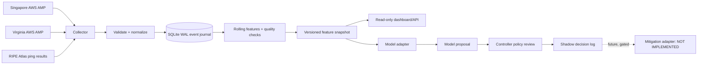

# AdaptiveNet

**Network-aware resilience, from real telemetry to safe decisions.**

AdaptiveNet compares a **Singapore** workload (`region-a`) with **N. Virginia** (`region-b`). It collects AWS-internal and RIPE Atlas external observations, builds timestamped feature snapshots, and exposes a clean contract for the ML and controller teams.

> **Current checkpoint (14 Oct 2026):** Both AWS regions are ingesting real internal metrics; `ready_for_internal_only_model=true` was verified on the user's Mac. RIPE measurements were stopped, so combined readiness is **false**. The controller is **shadow/review only**; **no AWS mitigation is connected or enabled**. These are historical verified results, not guarantees of current uptime.

## 1. How the system fits together



**Rules:** `null` means unknown, **not** zero; stale signals never become current by polling; a prediction is **not** permission to change routing.

## 2. Current status

| Area | Status | Evidence / limitation |
|---|---|---|
| AWS demo EC2 (SG + US) | Deployed | `/healthz` answered in both regions |
| Amazon Managed Prometheus | Connected | Application, CPU, memory and HTTP counters observed |
| Ingestion + storage | Working locally | Idempotent event inserts in SQLite WAL |
| Feature engineering | Working locally | Both regions internally fresh in latest verified test |
| HTTP catalog p95 | Traffic-dependent | May be `null` when 5-minute histogram rates cannot be evaluated |
| RIPE Atlas | Historical results | Two measurements stopped; fresh external signals not currently available |
| Model integration | Handoff contract + safe example | **No trained production model** |
| Controller | Policy review only | `approved_for_execution=false`; no AWS writes |
| Automatic AWS failover / EKS autoscaling | Not implemented | Route 53 routing disabled in the current demo |

## 3. Quick start (Mac)

From your existing repository root:

```bash
cd "$HOME/Downloads/adaptivenet 5"  # adjust if cloned elsewhere
source .venv/bin/activate          # or: python3 -m venv .venv && source .venv/bin/activate
python -m pip install -e '.[dev]'
python -m pytest -q

aws sso login --profile adaptivenet-admin
export SSL_CERT_FILE="$(brew --prefix ca-certificates)/share/ca-certificates/cacert.pem"
python scripts/ingestion.py once --profile adaptivenet-admin
```

Run continuous collection (Mac Terminal 1):

```bash
python scripts/ingestion.py watch --profile adaptivenet-admin --interval 120
```

Run the read-only API (Mac Terminal 2):

```bash
source .venv/bin/activate
python scripts/ingestion.py serve --port 8766
```

Open **http://127.0.0.1:8766**. The API only reads saved snapshots; the **`watch` process** is what collects data. This local API binds to loopback and has no user login: **never expose port 8766 publicly**.

`awscurl`, AWS CLI and valid AWS SSO authorization are required for live collection. If RIPE is stopped, the **combined model** will remain not ready; the **internal-only baseline** can still be ready.

## 4. For ML teammates — three commands

```bash
# Export snapshots as model input; never commit local experiment data by default.
python scripts/model_handoff.py input --mode internal_only --out data/model-input.json

# Run a conservative, non-ML baseline through controller review (no AWS writes).
python scripts/model_handoff.py demo --mode internal_only

# Export timestamped training examples (add controlled experiment labels separately).
python scripts/ingestion.py export --format jsonl --limit 200 --out data/features-v1.jsonl
```

Use `--mode combined` only when *both* AWS and RIPE signals are fresh. The model adapter keeps `null` values and adds explicit missing-value masks and snapshot age. It rejects an old snapshot for **live inference**, even if an older saved `ready` flag was true.

**Model input:** `adaptivenet.model_input.v1` → **model returns:** `adaptivenet.proposal.v1` → **controller reviews:** `adaptivenet.decision_review.v1`.

The proposed action vocabulary is `hold`, `investigate`, `shift_traffic`, `scale_out`. A model can **propose** a traffic shift, but the present controller deliberately never executes it. Start with `hold` / `investigate`; do not fabricate a route change for a demo.

Read **[ML + controller handoff](docs/TEAM_HANDOFF.md)** and **[data dictionary](docs/DATA_DICTIONARY.md)** before integrating a predictor. The code entry point is [`services/adaptivenet/ingestion/handoff.py`](services/adaptivenet/ingestion/handoff.py).

## 5. Interfaces and ownership

| Path | Teammate responsibility |
|---|---|
| `services/adaptivenet/ingestion/sources.py` | AWS AMP / RIPE collectors and normalization |
| `models.py`, `store.py`, `features.py` (same folder) | Immutable events → indexed journal → rolling features |
| `handoff.py` (same folder) | Versioned model input + safe baseline/example |
| `decisions.py` (same folder) | Validate model proposal, independently gate potential actions |
| `scripts/ingestion.py` | `once`, `watch`, `serve`, `export`, `review` |
| `scripts/model_handoff.py` | `input`, `demo`, `review` for classmates |
| `packages/contracts/src/` | TypeScript frontend/model contracts |
| `ml/` | Training, evaluation and future model adapters |
| `infra/terraform/` | Infrastructure: **do not apply** without a reviewed change |

API: `GET /v1/features/latest`, `GET /v1/features/history?limit=50`, `GET /v1/ingestion/status`.

Data structure choices: frozen `dataclass` observations; SHA-256 event IDs for deduplication; `defaultdict` for O(1)-average region/metric bucketing; bounded `deque` for rolling features; SQLite B-tree indexes for time-range lookup. The feature builder is **pure Python** and can be unit-tested offline. See the short explanations in [TEAM_HANDOFF.md](docs/TEAM_HANDOFF.md).

## 6. Team development and GitHub

```bash
# Start on a feature branch instead of changing main directly.
git switch -c feature/ingestion-ml-handoff
python -m pytest -q
python scripts/check_push_safety.py --staged  # after staging changes
# Stage only the intended source/docs; verify before pushing.
git status --short
```

For exact staging, commit, push and pull-request instructions, read **[GitHub handoff](docs/GITHUB_HANDOFF.md)**. **Never commit** `.env`, `.aws/`, `.venv/`, SQLite files, Terraform state, AWS credentials or RIPE creation keys.

## 7. What is still needed for the research demo?

1. **ML team:** label controlled faults (normal, congestion, HTTP 5xx, overload), train and evaluate a detector with chronological train/test splits; compare AWS-only vs AWS+RIPE fairly.
2. **Controller team:** shadow logging, consecutive-signal/hysteresis and cooldown logic, permissioned policy evaluation; *later* an independent health-verified reversible actuator.
3. **Experiment team:** bounded load + injected failures, recovery metrics, false positives, time-to-detect, confidence calibration and reproducible logs.
4. **Frontend team:** show model version, data age, uncertainty, proposals and review decisions without pretending that shadow actions changed AWS.

**No automatic mitigation is allowed until authenticated actuation, current-route readback, destination health, cooldown, idempotency, rollback and auditability are implemented and tested.**
