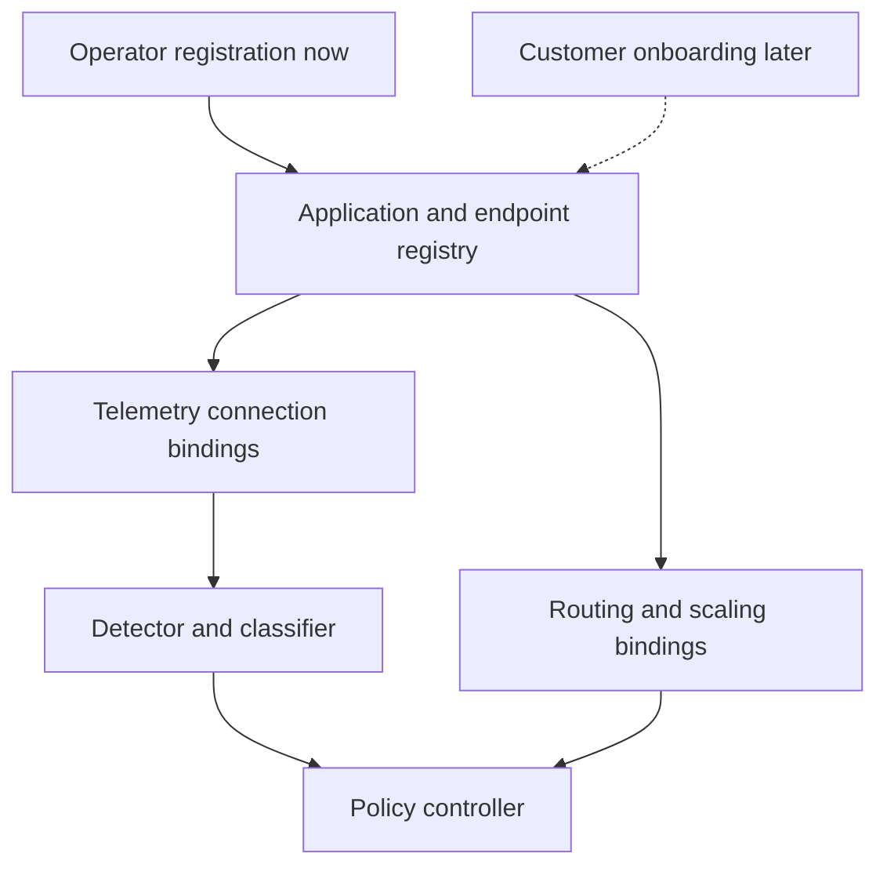
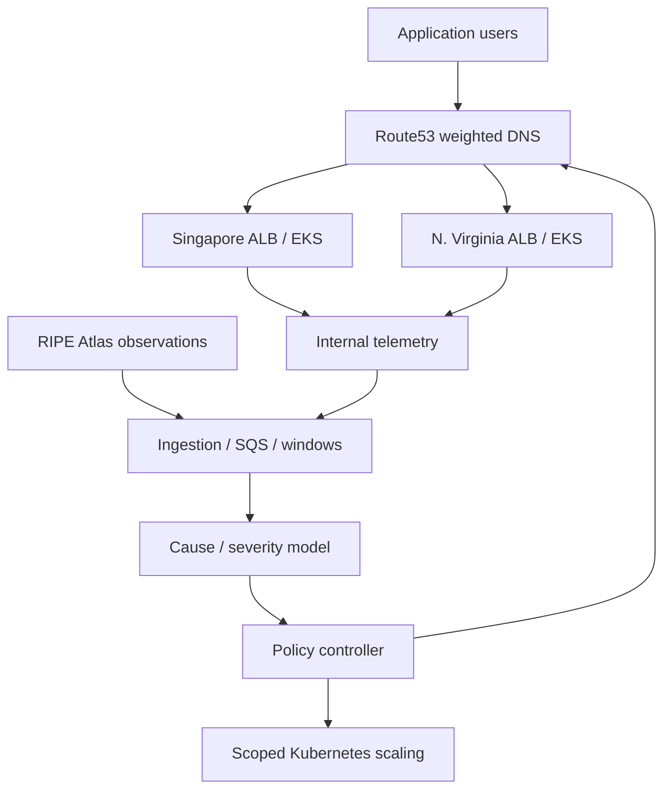

# AdaptiveNet architecture — implementation scope, 7 October 2026

## Proposal alignment

The supplied proposal describes an EKS target application spanning AZs/regions; external RIPE Atlas measurements combined with internal metrics; detector workers/model/controller; automatic scaling, rerouting/failover; controlled fault experiments and baseline comparisons. Its text does not require a customer signup wizard. The supplied diagram uses Route53 weighted DNS and Singapore/N. Virginia.

Preserve endpoint registration and eventual telemetry/mitigation integration. Defer self-service customer AWS enrollment and domain verification. A URL saved in the registry is not yet a verified or monitored connection. Nothing about creating this registration screen substitutes for the proposal's real telemetry/control-loop evaluation.

## Stable building blocks

| Component | Implemented now | Integration contract / later work |
|---|---|---|
| Next.js dashboard | Local experiment controls and Applications & endpoints page | Real charts, incident timeline and policy UI |
| Control API | Lab routes; application create/list/get | Authenticated tenant/operator ownership; integration lifecycle |
| Application registry | Persistent local SQLite records with stable app/endpoint IDs | PostgreSQL implementation behind the same API |
| Internal metrics adapter | Reserved boundary | Prometheus first, optional CloudWatch; scoped agent |
| External metrics adapter | Reserved boundary | RIPE manager/streamer plus protocol/target mapping |
| Ingestion + SQS | Event schema and deployable queue/DLQ foundation | Authenticated ingestion, deduplication and durable windows |
| Classifier | Reserved boundary | Rules baseline, then trained model with cause/severity/confidence |
| Controller | Reserved boundary | State, policy checks, idempotent journal, actuator acknowledgement |
| Routing adapter | Local manual simulator | Route53 first; optional Global Accelerator later |
| Scaling adapter | Reserved boundary | Namespaced Kubernetes/HPA operations |
| Experiment runner | Bounded local HTTP delay/error injection | Scoped real network/load/pod experiments |
| Delivery infrastructure | Bootstrap/ECR/OIDC, CI/build/publish, dev foundation | Regional EKS/ALB/DNS/database deployment modules |

## Configuration and onboarding path

Both manual registration and a future wizard write the same application/resource model. The inference pipeline references stable application_id and endpoint_id; it must not depend on whether configuration came from a wizard, API or imported manifest.

Each application owns endpoints. Each endpoint has region and target URL; later bindings identify Prometheus queries, cluster/namespace/workload, AWS account/role reference, hosted zone and Route53 record set ID. Store credential references, not access keys. The registry currently sets all connection states to `not_connected` and automation to `disabled`; clients cannot declare themselves protected by passing those fields.

Keep registration, ownership verification, telemetry freshness and actuator authorization separate. In a future hosted product, derive tenant ownership from operator/agent identity; reject caller-supplied ownership mismatches. Before performing server-side URL probes, add ownership verification, destination/IP validation, redirect controls and egress restrictions. The current registry never fetches the submitted URLs.

## Workload and runtime flow

The DNS arrows represent resolution choices: Route53 does not proxy HTTPS requests. Clients connect to the returned regional endpoint. DNS caches and existing connections affect mitigation time. Route53 weights influence DNS responses, not an exact real-time request split. Weighted aliases to ALBs use the target's TTL behaviour; do not promise an arbitrary near-zero TTL. A zero-weight record can still be considered under certain health/all-zero conditions. Test these behaviours and report observed traffic, rather than claiming zero weight is an absolute traffic block.

The optional Global Accelerator adapter is deferred. It would change both actuator semantics and the observed network path; compare that path separately. The current simulator's `region_a_percent` is not a production AWS routing API.

## Fault isolation

The stable demo frontend and operator dashboard sit outside the tested workload. The experiment runner must remain outside the node/cluster/region failure domain it disrupts. Different namespaces do not provide regional isolation. Local separate processes support functional development; real cloud experiments still need real regional deployments.

A stateless coffee catalogue avoids introducing database replication into the first routing experiment. The local demo gateway does not automatically protect applications registered through the new page; binding that control path is a subsequent integration step.

## Telemetry correctness

SQS Standard duplicates/reorders events. Persist using unique `(application_id,event_id)` keys and acknowledge only after commit. Multiple consumers must aggregate through shared storage, not independent partial in-memory windows. Claim windows transactionally by application/region/window end/feature version. Include event time, receipt time, coverage and freshness; missing signals are unknown.

Classify cause (healthy, compute overload, network degradation, critical failure, unknown) separately from controller states (Healthy, Degraded, Critical, Recovering). Build a deterministic baseline before training a model. Keep fault ground truth and experiment settings out of inference features.

The controller checks sustained evidence, confidence, destination health/capacity, cooldown and action expiry. Use one writer/lease per application and idempotent actions. Select one scaling owner: HPA-adjustment strategy or direct replicas, not both fighting over the same field. Record intended versus confirmed changes and recovery.

## Measurement constraints retained

The proposal mentions RIPE targeting application endpoints. An ALB does not become a useful ICMP echo target just because it has a public hostname. Validate protocol support and map network probe targets to application paths. Atlas HTTP measurement creation may require permission. Use eligible network/TLS measurements and independent application HTTP clients where needed.

Pod HTTP delay injection may not affect Atlas ICMP/TLS observations. Design real fault experiments so the affected hop is on the measured path. Synthetic/replayed external observations can validate software but must be labeled as such. A localhost-only test does not establish geographical or Internet-path resilience.

## Expansion without a rewrite

Keep interfaces for TelemetrySource, RoutingProvider, ScalingProvider and ApplicationRepository. Begin with local repository/simulator; add PostgreSQL, Prometheus/CloudWatch, Route53 and Kubernetes adapters behind those boundaries. A future enrollment service handles temporary AWS trust, domain ownership, cluster installation and revoke/disconnect, then records the same bindings. Do not bake credentials or a single tenant into the future detector/controller API.

The present local dashboard is single-operator and loopback-only. The data model prepares for later onboarding; it does not claim that hosted multitenancy/authentication has already been implemented.

Sources: [Route53 weights](https://docs.aws.amazon.com/Route53/latest/DeveloperGuide/routing-policy-weighted.html), [weighted aliases](https://docs.aws.amazon.com/Route53/latest/DeveloperGuide/resource-record-sets-values-weighted-alias.html), [SQS delivery](https://docs.aws.amazon.com/AWSSimpleQueueService/latest/SQSDeveloperGuide/standard-queues.html), [Kubernetes HPA](https://kubernetes.io/docs/concepts/workloads/autoscaling/horizontal-pod-autoscale/).
