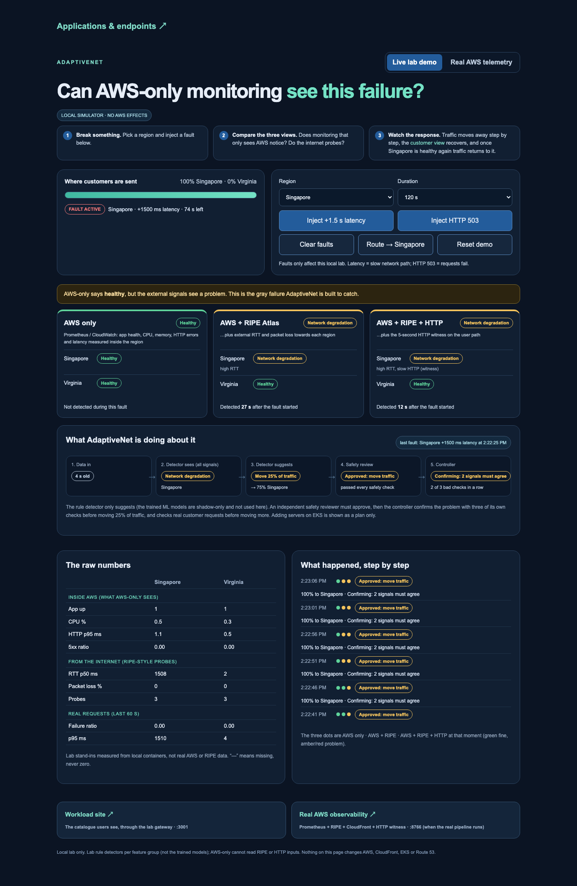

# AdaptiveNet: how to test our system

**Course:** CSC3104, Group 03\
**Repository:** https://github.com/Linus-Tay/adaptivenet, branch `v2`\
**Time needed:** about 30 minutes for Parts A and B (most of it is the first Docker build), and about 10 more minutes for Part C

## What AdaptiveNet does

AdaptiveNet watches a web service that runs in two AWS regions, Singapore (`region-a`) and Virginia (`region-b`). It combines AWS's own metrics with measurements taken from outside AWS (RIPE Atlas internet probes and real HTTP requests), decides whether a region is degraded, and moves traffic only after independent safety checks pass.

The claim we ask you to test is simple: **some network failures cannot be seen from inside AWS, and outside measurements can see them.** In our 20-trial packet-loss campaign on the real system, AWS metrics alone detected 0 of 20 faults, while AWS plus RIPE Atlas detected 13 of 20, with no false alarm in 20 healthy controls.

## What we expect you to test

The tests are in four parts. **Parts A, B and C need no AWS account, no RIPE Atlas account and no keys. Nothing in them contacts AWS.**

| Part | What you do | Time | What it shows |
|---|---|---|---|
| **A. Automated tests** | run 493 unit and integration tests and two smoke tests | 5 min | the collector, queue, feature snapshots, safety reviewer, confidence rules, safety controller and ML code behave as designed |
| **B. Docker demo** | start 13 containers and inject faults from a web page | 15–20 min | the whole loop working: a fault that AWS-only monitoring misses is detected by the external views, traffic is moved in bounded steps, and moved back when the region recovers |
| **C. Rerun our analysis** | rerun three analyses on the data we recorded on the real system | 5–10 min | the main numbers in our article come from the saved data and the committed code, not from hand editing |
| **D. Real AWS and RIPE (optional)** | rebuild the cloud system in your own AWS account | hours, costs money | the real deployment. **We have not tested a rebuild in a fresh account**, so we describe it and offer a live demonstration instead |

Each step below shows the command to type, **what you should see**, and what the step proves. Run every command from the repository root folder (`adaptivenet/`) unless the step says otherwise.

---

## 1. Install the tools

| Tool | Version we used | Needed for |
|---|---|---|
| Git | any recent | getting the code |
| Python | 3.11 or newer (we tested 3.12, 3.13 and 3.14) | Parts A and C |
| Docker Desktop (macOS/Windows) or Docker Engine with Compose v2 (Linux) | Engine 29.9, Compose v2 | Part B |
| A web browser | any | Part B |

Node.js, Terraform, Helm and the AWS CLI are **not** needed for Parts A to C.

```bash
git --version
python3 --version
docker --version
docker compose version
```

**Expected:** each command prints a version number. `python3 --version` must print 3.11 or higher.

> **macOS:** if `docker` is "command not found" although Docker Desktop is installed, run
> `export PATH=/Applications/Docker.app/Contents/Resources/bin:$PATH`
>
> **Windows:** the scripts are bash scripts. Use WSL 2 (Ubuntu) with Docker Desktop's WSL integration turned on, and run every command in the WSL terminal. *We have not tested Windows ourselves.*

---

## 2. Get the code and install the Python packages

```bash
git clone https://github.com/Linus-Tay/adaptivenet.git
cd adaptivenet
git checkout v2
```

**Expected:** `git checkout` prints `Switched to a new branch 'v2'` (or `Already on 'v2'`). `ls` shows folders such as `demo`, `services`, `ml`, `infra`, `tests` and the file `README.md`.

> `main` holds the frozen copy of the system we presented in class. `v2` holds the same system plus the 14–18 November live run, the analysis behind our final results, and the cleaned-up code. Please test `v2`.

Create a virtual environment and install the packages:

```bash
python3 -m venv .venv
source .venv/bin/activate
pip install -r requirements-dev.lock -r ml/team_starter/requirements-ml-inference.lock
pip install --no-deps -e .
```

**Expected:** your prompt now starts with `(.venv)`. The first `pip` command ends with `Successfully installed ...` (packages such as `fastapi`, `pytest`, `scikit-learn`, `numpy`, `scipy`), the second with `Successfully installed adaptivenet-0.1.0`. Both lock files are needed: without the second one, the ML tests fail on import. If you open a new terminal later, run `source .venv/bin/activate` again.

---

## 3. Part A: automated tests

### A1. All test suites

```bash
PYTHONPATH=services:. python -m pytest -q tests demo/tests ml/team_starter/tests step7_finish step8_finish
```

**Expected:** after about 10 seconds the last line is

```
493 passed, 1 warning, 4 subtests passed in 6.62s
```

The time will differ. The one warning is a library deprecation notice. **No test should fail.** None of these tests call AWS or the internet; AWS, RIPE and Kubernetes responses are replaced by fixtures.

| Folder | What the tests check |
|---|---|
| `tests/` | data collection (AWS Prometheus, RIPE Atlas, CloudFront); the SQS queue with outbox, duplicate removal and dead-letter queue; feature snapshots; the safety reviewer; the confidence rules; the safety controller (failover, failback, scaling); read-only EKS HPA access; the campaign action replay |
| `demo/tests/` | demo services, the fault command line, failback |
| `ml/team_starter/tests/` | datasets, training, evaluation, the RIPE value study, shadow prediction |
| `step7_finish/`, `step8_finish/` | the ML shadow inference service and final ML checks |

**What this shows:** each part of the pipeline does what the article describes, including the failure cases (duplicate messages, stale or future-dated data, a reviewer that blocks an unsafe proposal, a controller that refuses to move traffic to an unhealthy region).

### A2. End-to-end smoke test without Docker

```bash
PYTHONPATH=services:. python -m demo.smoke_local
```

**Expected** (about 1 to 2 minutes; the numbers can differ slightly):

```
baseline healthy: {'aws_only': 'healthy', 'aws_ripe': 'healthy', 'aws_ripe_http': 'healthy'}
injected 700 ms path latency on region-a (external path only)
during fault: {'aws_only': 'healthy', 'aws_ripe': 'network_degradation', 'aws_ripe_http': 'network_degradation'}
decisions: 12, failover decisions: 7, gateway region-a weight: 75%
...
PASS: gray failure seen only with external signals; bounded failover applied on the local gateway
```

**What this shows:** the main story in one run. AWS-only stays `healthy` during a network fault, the two views with external signals report `network_degradation`, and the gateway moves to 75% Singapore. The last line must start with `PASS`.

### A3. Control-plane smoke test (also run in our CI)

```bash
python scripts/smoke.py
```

**Expected:** some server log lines, then

```
PASS: auth, baseline, fault, healthy control plane, B routing, expiry, bounds, latency, cleanup
```

**What this shows:** the lab control plane rejects unauthenticated requests, keeps traffic changes within bounds, and expires faults on time.

---

## 4. Part B: the Docker demo

The demo runs the full loop in 13 local containers:

```
local probes (stand-ins for AWS metrics, RIPE Atlas and the HTTP witness)
  -> collector -> outbox -> queue -> feature worker -> snapshots
  -> rule detector -> proposal -> confidence rules
  -> independent safety reviewer -> decision
  -> safety controller moves traffic on the LOCAL gateway only
```

It makes no AWS calls and uses no credentials. The values are real measurements of local containers, labelled as lab data. The detector in the demo is a set of transparent threshold rules (`demo/lab/detectors.py`). The trained ML models run only in shadow mode and never drive the controller; Part C explains why.

### B1. Start the demo

Start Docker and check that ports 3000, 3001, 8000, 8001, 8080, 8101, 8102, 8190 and 8192 are free (for example, a local LM Studio server often uses 8080).

> **Linux only:** the containers run as a non-root user (uid 10001) and write to `data/`. Run this once first, or some containers restart in a loop with "Permission denied":
> ```bash
> mkdir -p data/lab-live data/demo-live data/demo-replay data/demo-models && chmod -R a+rwX data
> ```

```bash
demo/run.sh lab-up
```

**Expected:** the first run builds the images, which takes several minutes. It ends with

```
Group lab: dashboard http://127.0.0.1:3000  site http://127.0.0.1:3001
Detector + safety decisions: http://127.0.0.1:8190
```

```bash
docker ps --format '{{.Names}}  {{.Status}}'
```

**Expected:** 13 containers whose names start with `adaptivenet-lab-` (for example `adaptivenet-lab-dashboard-1`, `adaptivenet-lab-gateway-1`, `adaptivenet-lab-lab-controller-1`), all `Up`, none `Restarting`.

### B2. Open the pages

Wait about 30 seconds, then open:

| Address | What you should see |
|---|---|
| http://127.0.0.1:3000 | **Main demo page.** Title "Can AWS-only monitoring see this failure?", a "Where customers are sent" bar at **100% Singapore · 0% Virginia**, fault buttons, and three cards (AWS only, AWS + RIPE Atlas, AWS + RIPE + HTTP), all **Healthy** |
| http://127.0.0.1:3001 | the demo web site (a product catalogue served through the gateway) |
| http://127.0.0.1:8190 | the raw decision-service view, for debugging |

The "What AdaptiveNet is doing about it" row should read: Data in "a few s old", Detector sees **Healthy**, Detector suggests **Do nothing**, Safety review **No action**, Controller **Idle**.

### B3. Test 1: a network fault that AWS cannot see (the main test)

On http://127.0.0.1:3000:

1. Press **Reset demo** and wait about 30 seconds.
2. Leave **Region** on **Singapore** and **Duration** on **120 s**.
3. Press **Inject +1.5 s latency**.

This adds 1.5 seconds of delay on the network path to Singapore. The servers stay healthy, which is the kind of "gray failure" that monitoring inside AWS misses.

**Expected sequence** (times from our runs on 13 Nov 2026; yours may differ by some seconds):

| Time after pressing | What the page shows |
|---|---|
| 0 s | a red **FAULT ACTIVE** badge: "Singapore · +1500 ms latency" |
| about 10–15 s | the **AWS + RIPE + HTTP** card shows **Network degradation**, with "Detected *N* s after the fault started" |
| about 20 s | the **AWS + RIPE Atlas** card also shows **Network degradation** |
| the whole time | **AWS only** stays **Healthy** ("Not detected during this fault"), and a yellow banner says "AWS-only says healthy, but the external signals see a problem." |
| about 20–60 s | Detector suggests **Move 25% of traffic**, Safety review **Approved: move traffic**, Controller **Confirming** (it needs 2 of 3 signals to agree for 3 windows, then 3 fresh checks of its own) |
| about 1 minute | the traffic bar moves to **75% Singapore · 25% Virginia** |
| about 2 minutes | if the fault is still active, a further step to **50% · 50%** |
| after the fault ends | the cards return to **Healthy**; Controller shows "Waiting: Singapore must stay healthy" |
| about 2–3 minutes after the fault ends | traffic steps back to **75%**, then **100% Singapore** (failback); Controller returns to **Idle** |



The full cycle took about 5 minutes in our runs. The "What happened, step by step" log on the right records each decision with a time stamp.

**What this shows:** with the same data, the view that uses only AWS-internal metrics cannot see a network-path fault, while the views that add outside measurements detect it. The system then moves traffic in bounded 25-point steps, only after the confidence rules, the safety reviewer and its own fresh checks agree, and moves it back once the region stays healthy.

### B4. Test 2: an HTTP error fault

1. Press **Reset demo** and wait about 30 seconds.
2. Press **Inject HTTP 503** (Singapore, 120 s).

**Expected:** within about a minute, **AWS + RIPE Atlas** and **AWS + RIPE + HTTP** show **Network degradation** for Singapore while **AWS only** stays **Healthy**. (In this lab the 503 errors are injected on the gateway path that outside users take, so the servers' own metrics stay clean.) Safety review shows **Approved: move traffic**. The traffic bar moves to **75% · 25%** after about 40–45 s, to **50% · 50%** after about 75–85 s and, if the fault is still active, to **25% · 75%** at about 115 s. After the fault ends, traffic returns to **100% Singapore** in 25-point steps (about 3 minutes after the fault ended in our run).

**What this shows:** a second fault type, a larger move when the fault persists, and that the controller never moves more than 25 points in one step.

### B5. The same faults from the command line (optional)

```bash
set -a; source demo/.env.demo; set +a
PYTHONPATH=services:. python -m demo.faultctl lab-latency --region sg --ms 1500 --duration 120
PYTHONPATH=services:. python -m demo.faultctl lab-errors --region sg --rate 1.0
```

**Expected:** JSON output containing `"status": "active"`, then `"latency_ms": 1500` or `"error_rate": 1.0`. The main page then behaves as in B3 or B4. (`demo/.env.demo` is created by `demo/run.sh` and holds only a random local token for the lab, not an AWS credential.)

### B6. Reset and stop

```bash
demo/run.sh lab-reset
demo/run.sh lab-down
```

**Expected:** `lab-reset` restarts the gateway and lab controller (traffic back at 100% Singapore, faults cleared). `lab-down` prints `Removed` for each container and the network; `docker ps` then shows no `adaptivenet-lab-` containers.

### B7. Packet-loss stack (optional)

A second, 10-container stack has its own emulated internet path, so it can also inject packet loss, application errors and CPU load. Its page is the raw decision view only.

```bash
demo/run.sh up
PYTHONPATH=services:. python -m demo.faultctl latency --region sg --ms 700
```

**Expected:** open http://127.0.0.1:8190. About 20–30 s after the fault, `aws_ripe` and `aws_ripe_http` show `network_degradation` for region-a while `aws_only` stays `healthy`; within about 2 minutes the gateway's region-a share drops (it reached 50% in our run). Other faults: `loss --region sg --pct 50`, `app-5xx --region us --rate 0.5`, `cpu --region sg`, `region-down --region sg`. Expected outcomes for each are in `demo/DEMO.md`, section 2. Stop with `demo/run.sh down`. Run only one stack at a time.

---

## 5. Part C: rerun our analysis from the saved data

Parts A and B use local stand-ins. The numbers in our article come from the **real** system: two EC2 regions, Amazon Managed Prometheus, four RIPE Atlas probes and an HTTP witness, recorded on 12 November (the 20-trial campaign) and 14 to 18 November (the live run and 10 more trials). Part C reruns the analysis on that recorded data with the committed code. No account is needed, because the data is already saved.

### C0. Get the saved data

The saved data is in two folders of the repository: `evidence/ripe-campaign-20261112/` (the 12 November campaign) and `evidence/live-shadow-20261114/` (the 14–18 November live run). Set two variables:

```bash
export CAMP=evidence/ripe-campaign-20261112
export LIVE=evidence/live-shadow-20261114
ls $CAMP $LIVE
```

**Expected:** the first folder holds `campaign-plan.json`, `campaign-log.jsonl`, `amp-region-a.jsonl`, `amp-region-b.jsonl`, `ripe/`, `trials/` and `http_witness.jsonl`; the second holds `amp-region-*.jsonl`, `ripe-region-*.json`, `http_witness.jsonl`, `exclusions-ssm.json`, `retrain-report.json` and `trials/`.

| File or folder | What it is |
|---|---|
| `campaign-plan.json`, `campaign-log.jsonl`, `trials/` | the 20 pre-registered fault slots, when each fault ran, and the AWS SSM confirmation of each fault (the ground truth) |
| `amp-region-*.jsonl` | AWS-internal metrics exported from Amazon Managed Prometheus |
| `ripe/236862553.json`, `ripe/236862555.json` | the RIPE Atlas ping results for Singapore and Virginia |
| `http_witness.jsonl` | the HTTP witness (one request every 15 s) |
| `$LIVE` folder | the 14–18 November live run: metrics, RIPE results, witness, the 10 extra fault trials, the SSM exclusion list and the saved scoring report |

The data contains our AWS account number and EC2 instance IDs (they appear in the SSM records). These are identifiers, not credentials.

### C1. The campaign result (AWS-only 0/20, AWS+RIPE 13/20)

```bash
PYTHONPATH=services:. python -m ml.team_starter.ripe_value study \
  --ripe region-a=$CAMP/ripe/236862553.json --ripe region-b=$CAMP/ripe/236862555.json \
  --campaign-dir $CAMP --campaign-plan $CAMP/campaign-plan.json
```

**Expected** (under a second): a line that starts with `campaign` and contains

```
"evaluable_episodes": 20, "both_detected": 0, "aws_only_only": 0, "aws_ripe_only": 13, "neither": 7,
"aws_only_recall": 0.0, "aws_ripe_recall": 0.65, ... "mcnemar_exact_p": 0.000244140625
... {"evaluable": 20, "aws_only": 0, "aws_ripe": 0}
```

The last part is the 20 same-time healthy controls: neither rule alarmed on any of them. The full report is written to `data/ml-results/native/ripe-value/ripe-value-report.json`.

**What this shows:** the article's main result. Each fault is a real firewall rule on one EC2 instance, confirmed by AWS SSM, so the labels do not depend on RIPE. The rules were frozen before the campaign. AWS metrics saw none of the 20 faults; adding RIPE found 13, with no false alarm, and the difference is significant (exact McNemar p = 0.00024).

### C2. What the controller would have done (action replay)

```bash
python scripts/action_replay_campaign.py --campaign-dir $CAMP \
  --http-deadline-ms 500 --http-deadline-ms 2000 --out /tmp/action-replay.json
cmp /tmp/action-replay.json docs/ml/action-replay-campaign.json && echo SAME
```

**Expected** (about 3 minutes): four summary lines, the first of which is

```
campaign {"trials": 20, "would_fail_over_away_from_impaired_region": 1, "failover_delays_s": [210],
 "false_actions_in_control_windows": 0, ... } healthy gaps: 1.58 h, 0 actions
```

then `SAME`: your output is byte-for-byte identical to the committed result.

**What this shows:** the real campaign data fed through the real decision path (detector, safety reviewer, confidence rules, safety controller). The safety chain is cautious: at our 500 ms HTTP deadline it would have moved traffic in 1 of 20 trials, after 210 s, and it never took a false action in the 20 control windows or 1.6 hours of healthy time. Most trials were held back because the HTTP witness did not also see the fault, and the controller needs 2 of 3 views to agree. We report this as a limit, not a success.

### C3. The ML results on unseen faults (amendment 10)

```bash
PYTHONPATH=services:. python -m ml.team_starter.amendment10 $CAMP $LIVE
```

**Expected** (about 30 seconds): a table headed `Amendment 10 (POST-HOC, ...)` that is identical to the section of the same name at the end of `docs/ml/live/WEDNESDAY_RESULTS.md`. Some rows to check:

| Detector | False alarms per region per day, as pre-registered | corrected |
|---|---|---|
| 13 Nov model (current/anomaly_aws_ripe_no_host) | 28.14, 77 onsets, 65.667 h | 25.68, 68 onsets, 63.542 h |
| frozen loss_only rule (comparator) | 5.12, 14 onsets | 2.64, 7 onsets |
| supervised S1 | 6.94, 19 onsets | 4.91, 13 onsets |
| supervised S2 | 21.93, 60 onsets | 17.75, 47 onsets |

and the last line: `AWS-only view of the frozen rule on the Tuesday trials: 0/10 trials detected, controls alarmed 0/10.`

**What this shows:** how we tested the ML honestly. The protocol (`docs/ml/LIVE_SHADOW_PROTOCOL.md`) was committed before the live data existed. Each model and its pass mark were frozen before 10 new faults on 17 November and before 65.7 hours of held-out healthy time were scored. **No ML model passed its pre-registered mark.** The simple loss rule again beat AWS-only (8 of 10 against 0 of 10, no control alarm, p = 0.008), which repeats the campaign result on new faults. After the run we found that the original count charged detectors for alarms during the real faults. We corrected this openly (amendment 10): both counts are shown and no verdict changed. This is why the ML stays in shadow mode and never moves traffic.

### C4. Full rescoring of the live run (optional, slow)

```bash
PYTHONPATH=services:. python -m ml.team_starter.live_shadow retrain --campaign-dir $CAMP --live-dir $LIVE
```

**Expected** (about 3 minutes): this retrains and rescores every model on the live data and rewrites `$LIVE/RETRAIN.md` and `$LIVE/retrain-report.json`. The new `RETRAIN.md` matches the part of `docs/ml/live/WEDNESDAY_RESULTS.md` above the amendment 10 section, for example `current/anomaly_aws_ripe_no_host | 28.14 (22.21-35.17) | 77 | 65.667 | 17/20`. It has one extra context row, `context/frozen_aws_rule | 2.19 ...`, which was added with amendment 10; no other number changes. The command does not touch git (only the group's own run used `--commit`). C3 does not need C4. Copy `$LIVE` first if you want to keep the original files.

---

## 6. Part D: the real AWS and RIPE Atlas system (optional)

The real system ran on the group's AWS account: EC2 web servers in Singapore and Virginia behind one CloudFront distribution, Amazon Managed Prometheus in each region, an SQS queue with a dead-letter queue, CloudWatch alarms, and an EKS cluster in Singapore with a Kubernetes HPA. It used RIPE Atlas ping measurements from four probes. **The repository contains no credentials.**

### D1. What we can offer instead of a rebuild

The group's AWS environment is still in place. **Please contact CSC3104 Group 03 if you would like a live demonstration or temporary access.** The two live tests we ran on 13 November are documented, with their raw evidence, in `docs/LIVE_TESTS_20261113.md`:

- *CloudFront failover:* we stopped the Singapore service for 60 s. All 108 requests through CloudFront returned HTTP 200; the 27 sent during the outage were served by Virginia.
- *EKS scale-up:* a bounded load job made the Kubernetes HPA scale from 2 to 4 pods; 10,762 requests, 0 failed.

In both tests AWS's own mechanisms acted (CloudFront origin failover, the HPA), not the AdaptiveNet controller, which only changes the local lab gateway. Each test ran once.

### D2. Rebuilding it in your own account

**We have never rebuilt the system in a fresh AWS account, so these steps are untested and may need fixes.** They need your own AWS account (it costs money while it runs), Terraform 1.13.5, the AWS CLI and, for EKS, Helm and kubectl. The RIPE part needs a RIPE Atlas account with an API key and enough credits.

| Step | Folder or script | What it creates |
|---|---|---|
| 1 | `infra/terraform/bootstrap` (copy `terraform.tfvars.example`) | the Terraform state bucket, an artifacts bucket and a GitHub OIDC role |
| 2 | `infra/terraform/environments/dev` (copy `backend.hcl.example`) | the SQS queue and dead-letter queue, IAM policies, CloudWatch alarms |
| 3 | `infra/terraform/environments/demo-cloud` | the two EC2 web servers (Singapore, Virginia) with their VPCs; Route 53 stays off (`enable_route53 = false`, see the README) |
| 4 | `infra/terraform/environments/platform` | Amazon Managed Prometheus per region; the EKS cluster only with `enable_eks = true` |
| 5 | `infra/terraform/environments/cloudfront` | the CloudFront distribution with Singapore as primary origin and Virginia as failover |
| 6 | `infra/helm/demo` | the EKS app with its HPA |
| 7 | `scripts/ripe_campaign_measurements.py` (reads `ATLAS_API_KEY`) | the RIPE Atlas ping measurements to both origins; this spends RIPE credits |

Several values are tied to our account and must be changed: the AMP workspace IDs and queue settings in `.env` (copy `.env.example`), the RIPE target addresses and measurement IDs, and the EC2 instance IDs in `scripts/aws_fault.py`. After that, the real pipeline runs with `python scripts/live_monitor.py --sqs` (dashboard on port 8766), and guarded faults run through `scripts/aws_fault.py`, which schedules its own recovery before it starts a fault. Always review `terraform plan` before `terraform apply`.

---

## 7. Troubleshooting

| Problem | Fix |
|---|---|
| `docker: command not found` on macOS | `export PATH=/Applications/Docker.app/Contents/Resources/bin:$PATH` |
| `Cannot connect to the Docker daemon` | start Docker Desktop (or `sudo systemctl start docker` on Linux) and wait until it is running |
| `port is already allocated` | another program uses one of the ports in B1. Stop it, run `demo/run.sh lab-down`, then `demo/run.sh lab-up` |
| containers keep `Restarting`, logs show `Permission denied: '/app/data/...'` (Linux) | run the `chmod` command in B1, then `lab-down` and `lab-up` |
| `ModuleNotFoundError` | activate the environment (`source .venv/bin/activate`), run from the repository root, keep the `PYTHONPATH=services:.` prefix, and check that both lock files were installed |
| cards say "unknown" or the data is old right after start | wait 30–60 seconds for the first probe rounds |
| demo seems stuck after many faults | `demo/run.sh lab-reset`, then wait 30 seconds |
| Part C: `FileNotFoundError` for a trial file | check that `$CAMP` and `$LIVE` point at the saved data folder, and that you run from the repository root |

---

## Appendix: how we checked these instructions

- **Parts A and C** (18 Nov 2026): on a clean Linux machine (Python 3.13) with a fresh copy of `v2` (commit `2170d47`) and the saved data in `evidence/`: 493 passed, 0 failed; both smoke tests printed `PASS`; C1 printed 0/20 against 13/20 and p = 0.000244; C2's output was byte-for-byte identical to `docs/ml/action-replay-campaign.json` (167 s); C3's output was identical to the amendment 10 section of `docs/ml/live/WEDNESDAY_RESULTS.md`; C4 (158 s) reproduced every row of the official report and made no git commit.
- **Part B** (13 Nov 2026): on a clean Linux machine (Docker Engine 29.9.2, Python 3.12), `lab-up` started all 13 containers; in Test 1 the HTTP view flagged Singapore after 11 s and the RIPE view after 21 s, traffic went 100→75% at about 65 s and 75→50% at about 120 s, and returned to 100% at about 286 s; Test 2 was detected by both external views; `lab-reset` and `lab-down` worked. The group also ran `lab-up` on macOS with Docker Desktop.
- **Not tested by us:** Windows (WSL 2), and a rebuild of Part D in a fresh AWS account.
