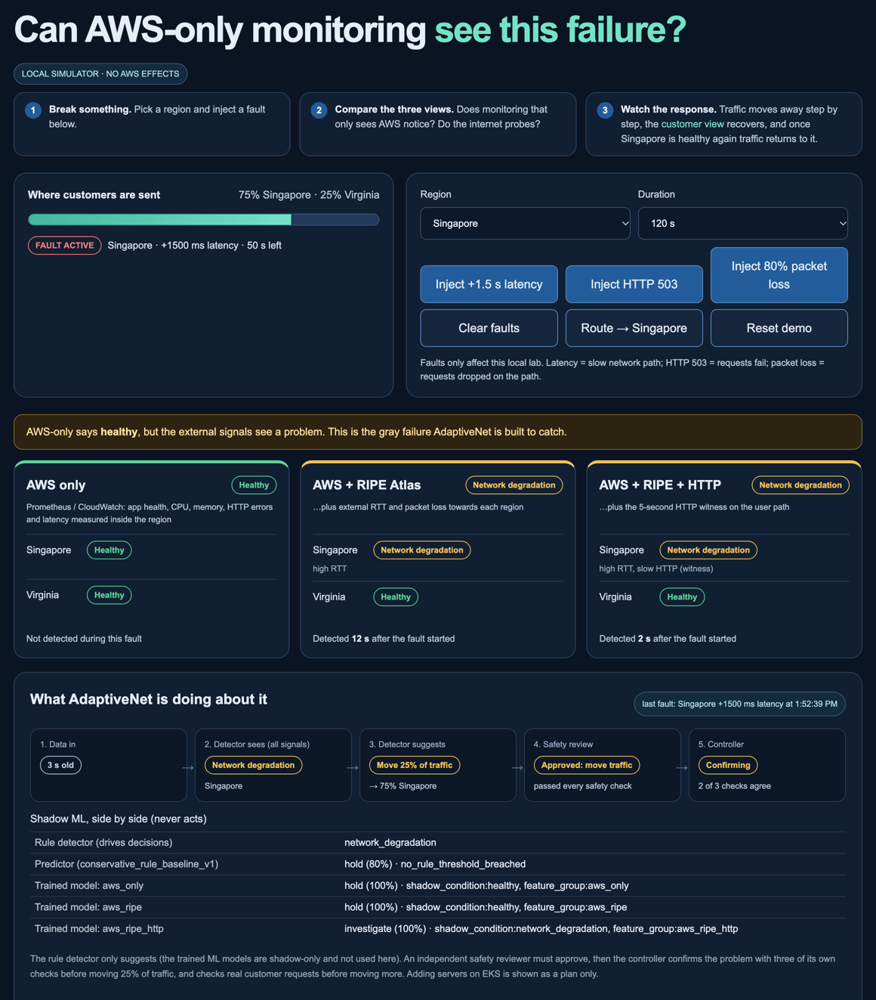

# AdaptiveNet: how to test our system

**CSC3104 Group 03** · Repository: https://github.com/Linus-Tay/adaptivenet (branch `main`) · Time: about 40 minutes, most of it the first Docker build

AdaptiveNet watches a web service in two AWS regions, Singapore and Virginia. It combines AWS's own metrics with measurements from outside AWS (RIPE Atlas internet probes and real HTTP requests), decides whether a region is degraded, and moves traffic only after independent safety checks pass. The claim to test: **some network failures cannot be seen from inside AWS, and outside measurements can see them.**

| Part | What you do | Time | What it shows |
|---|---|---|---|
| **A. Tests** | run 500 automated tests and a smoke test | 5 min | each component behaves as designed, including the failure cases |
| **B. Docker demo** | start the demo in Docker and inject three faults from a web page | 20 min | a fault that AWS-only monitoring misses is caught from outside, traffic moves away in safe steps and comes back |
| **C. Our analysis** | rerun three analyses on the data we recorded on the real AWS system | 5 min | the article's main numbers come from the saved data and the committed code |

**No AWS account, RIPE account or key is needed. Nothing here contacts AWS.**

## 1. Download and install

| You need | Where |
|---|---|
| **Python 3.11 or newer** | https://www.python.org/downloads/ (on Windows, tick **"Add python.exe to PATH"**) |
| **Docker Desktop** (includes Docker Compose) | https://www.docker.com/products/docker-desktop/ (start it and wait until it is running) |
| Git (optional) | https://git-scm.com/downloads, only if you clone instead of using the ZIP |

Get the code: download https://github.com/Linus-Tay/adaptivenet/archive/refs/heads/main.zip and unzip it (or `git clone https://github.com/Linus-Tay/adaptivenet.git`). Open a terminal in that folder: Terminal on macOS or Linux, PowerShell on Windows.

## 2. Two ways to run every step

**Way 1: our script `run.py`** works the same on macOS, Linux and Windows. On macOS and Linux type `python3` if `python` is not found.

```
python run.py check        # checks Python, Docker and the demo ports
python run.py setup        # creates .venv and installs the Python packages
python run.py test         # Part A
python run.py demo-up      # Part B: start the demo
python run.py fault lab-latency --region sg --ms 1500 --duration 120
python run.py status       # active faults
python run.py demo-reset   # clear faults, traffic back to 100% Singapore
python run.py demo-down    # stop the demo
```

**Way 2: without `run.py`**, the same steps by hand.

macOS / Linux:

```
python3 -m venv .venv && source .venv/bin/activate
pip install -r requirements-dev.lock -r ml/team_starter/requirements-ml-inference.lock
pip install --no-deps -e .
export PYTHONPATH=services:.
python -m pytest -q tests demo/tests ml/team_starter/tests step7_finish step8_finish
python -m demo.smoke_local
mkdir -p data/lab-live data/demo-replay data/demo-models && chmod -R a+rwX data   # Linux only
demo/run.sh lab-up
python -m demo.faultctl lab-latency --region sg --ms 1500 --duration 120
demo/run.sh status
demo/run.sh lab-reset
demo/run.sh lab-down
```

Windows PowerShell:

```
python -m venv .venv
Set-ExecutionPolicy -Scope Process Bypass
.venv\Scripts\Activate.ps1
python -m pip install -r requirements-dev.lock -r ml\team_starter\requirements-ml-inference.lock
python -m pip install --no-deps -e .
$env:PYTHONPATH = "services;."
python -m pytest -q tests demo/tests ml/team_starter/tests step7_finish step8_finish
python -m demo.smoke_local
powershell -ExecutionPolicy Bypass -File demo\run.ps1 lab-up
python -m demo.faultctl lab-latency --region sg --ms 1500 --duration 120
powershell -ExecutionPolicy Bypass -File demo\run.ps1 status
powershell -ExecutionPolicy Bypass -File demo\run.ps1 lab-reset
powershell -ExecutionPolicy Bypass -File demo\run.ps1 lab-down
```

The rest of this guide shows the `run.py` command for each step; the matching Way 2 command is in the lists above.

### Check and install

```
python run.py check
python run.py setup
```

**Expected:** `check` prints one line per item, `OK` or a `FIX` line that says what to do, and ends with `All required prerequisites are present.` (the `.venv not created yet` and `AWS CLI not found` lines are fine). `setup` takes about a minute and ends with `Setup done. Next:  python run.py test`.

---

## 3. Part A: automated tests

```
python run.py test
```

**Expected** (1 to 2 minutes). The test run ends with

```
500 passed, 1 warning, 4 subtests passed
```

(the warning is a library deprecation notice; **no test should fail**). Then the smoke test, which runs every demo service as a local process without Docker, ends with

```
during fault: {'aws_only': 'healthy', 'aws_ripe': 'network_degradation', 'aws_ripe_http': 'network_degradation'}
decisions: 12, failover decisions: 7, gateway region-a weight: 75%
...
PASS: gray failure seen only with external signals; bounded failover applied on the local gateway
```

(the counts can differ slightly; the last line must be `PASS`).

**What this shows.** The tests cover data collection (AWS Prometheus, RIPE Atlas, CloudFront), the queue with outbox, duplicate removal and dead-letter queue, feature snapshots, the safety reviewer, the confidence rules, the safety controller (failover, failback, scaling) and the ML code, all with fixtures in place of AWS. The smoke test is the main story in one run: during a network fault the AWS-only view stays `healthy`, the views with outside signals report `network_degradation`, and traffic moves to 75% Singapore.

---

## 4. Part B: the Docker demo

The demo runs the whole loop in 11 local containers: two origins (Singapore, Virginia), a gateway that stands in for CloudFront, a collector and feature worker, the detector, the safety controller, simulated users, the control-room page and a demo café website. The controller can only change the split on the local gateway.

### Start

```
python run.py demo-up
```

**Expected:** the first run builds the images (several minutes) and ends with

```
Demo dashboard: http://127.0.0.1:3000   cafe site: http://127.0.0.1:3001   debug: http://127.0.0.1:8192
```

`docker ps` then lists 11 containers named `adaptivenet-lab-...`, all `Up`. Wait about 30 seconds, then open:

- **http://127.0.0.1:3000**, the control room: "Can AWS-only monitoring see this failure?", a traffic bar at **100% Singapore · 0% Virginia**, three fault buttons, three cards (**AWS only**, **AWS + RIPE Atlas**, **AWS + RIPE + HTTP**), all **Healthy**, and the pipeline row (Detector, Safety review, Controller) at **Do nothing / No action / Idle**.
- **http://127.0.0.1:3001**, Harbour Lane Coffee, the café the simulated users visit. Its *Behind the scenes* tab shows each request's load time and which region served it.

### Test 1: a network fault that AWS cannot see (the main test)

On the control room, press **Reset demo**, wait 30 s, leave **Singapore** and **120 s**, and press **Inject +1.5 s latency**. The servers stay healthy; only the network path to Singapore becomes slow.

| After about | What you should see |
|---|---|
| 0 s | red **FAULT ACTIVE** badge |
| 5–15 s | **AWS + RIPE + HTTP** and then **AWS + RIPE Atlas** show **Network degradation**; **AWS only** stays **Healthy** the whole time, with a yellow banner "AWS-only says healthy, but the external signals see a problem." |
| 20–60 s | Detector suggests **Move 25% of traffic**, Safety review **Approved: move traffic**, Controller **Confirming** |
| 75 s | traffic bar **75% Singapore · 25% Virginia** |
| later | while the fault lasts, possibly a further step to 50 · 50 |
| about 2 min after the fault ends | traffic steps back to **100% Singapore**; Controller **Idle** |



**What this shows:** with the same data, the AWS-only view misses a network-path fault and the views with outside measurements catch it. Traffic then moves in bounded 25-point steps, only after the confidence rules, an independent safety reviewer and the controller's own checks agree, and moves back when the region is healthy.

### Test 2: HTTP errors

**Reset demo**, wait 30 s, press **Inject HTTP 503**. **Expected:** within about 5 s both outside views show **Network degradation** while **AWS only** stays **Healthy**; traffic moves to **75 · 25** (about 100 s in our run), and back to 100% after the fault ends.

### Test 3: packet loss

**Reset demo**, wait 30 s, press **Inject 80% packet loss**. **Expected:** both outside views flag Singapore within about 5 s, **AWS only** stays **Healthy**, traffic goes to **75 · 25** (about 66 s) and **50 · 50** (about 106 s), then back to 100%. This is the same kind of fault as our real campaign.

### Faults from the command line, reset and stop

```
python run.py fault lab-latency --region sg --ms 1500 --duration 120
python run.py fault lab-errors --region sg --rate 1.0
python run.py fault lab-loss --region sg --pct 80
python run.py status
python run.py demo-reset
python run.py demo-down
```

**Expected:** each `fault` prints JSON with `"status": "active"`, and the page reacts as in Tests 1 to 3. `demo-down` removes all the containers.

The **Shadow ML** panel on the control room shows the rule detector and a baseline; the trained models are not shipped, so their rows say "none loaded". That is expected and does not affect the tests.

---

## 5. Part C: rerun our analysis from the recorded data

The article's numbers come from the real system (two EC2 regions, Amazon Managed Prometheus, four RIPE Atlas probes, an HTTP witness), recorded on 12 November (20-trial campaign) and 14–18 November (live run and 10 more faults). The recordings are in the repository under `evidence/`. Run these after `python run.py setup`.

macOS / Linux:

```
source .venv/bin/activate
export PYTHONPATH=services:.
export CAMP=evidence/ripe-campaign-20261112
export LIVE=evidence/live-shadow-20261114
```

Windows PowerShell (then write `$env:CAMP` and `$env:LIVE` for `$CAMP` and `$LIVE` below, and type each command on one line):

```
Set-ExecutionPolicy -Scope Process Bypass
.venv\Scripts\Activate.ps1
$env:PYTHONPATH = "services;."
$env:CAMP = "evidence/ripe-campaign-20261112"
$env:LIVE = "evidence/live-shadow-20261114"
```

### C1. The campaign: AWS-only 0/20, AWS + RIPE 13/20

```
python -m ml.team_starter.ripe_value study --ripe region-a=$CAMP/ripe/236862553.json --ripe region-b=$CAMP/ripe/236862555.json --campaign-dir $CAMP --campaign-plan $CAMP/campaign-plan.json
```

**Expected** (under a second): a line starting `campaign` that contains `"aws_only_only": 0, "aws_ripe_only": 13, "neither": 7`, `"aws_only_recall": 0.0, "aws_ripe_recall": 0.65`, `"mcnemar_exact_p": 0.000244140625` and, for the 20 healthy controls, `{"evaluable": 20, "aws_only": 0, "aws_ripe": 0}`.

**What this shows:** our main result. Each fault was a real firewall rule on one EC2 instance, confirmed by AWS; the rules were frozen beforehand. AWS metrics saw none of the 20 faults, adding RIPE found 13 with no false alarm (exact McNemar p = 0.00024).

### C2. What the safety controller would have done

```
python scripts/action_replay_campaign.py --campaign-dir $CAMP --http-deadline-ms 500 --http-deadline-ms 2000 --out replay.json
```

**Expected** (about 3 minutes): the first summary line contains `"trials": 20, "would_fail_over_away_from_impaired_region": 1, "failover_delays_s": [210], "false_actions_in_control_windows": 0` and ends `healthy gaps: 1.58 h, 0 actions`. The file `replay.json` is identical to `docs/ml/action-replay-campaign.json` (check with `cmp replay.json docs/ml/action-replay-campaign.json` on macOS/Linux, or `fc.exe /b replay.json docs\ml\action-replay-campaign.json` on Windows).

**What this shows:** the real data fed through the real decision chain. It is cautious: it would have moved traffic in 1 of 20 trials and never took a false action. We report this as a limit.

### C3. The ML models on unseen faults

```
python -m ml.team_starter.amendment10 $CAMP $LIVE
```

**Expected** (about 30 seconds): a table headed `Amendment 10 (POST-HOC, ...)`, identical to the end of `docs/ml/live/WEDNESDAY_RESULTS.md`. For example `frozen loss_only rule (comparator) | 5.12 (2.8-8.59), 14 onsets, 65.667 h | 2.64 (1.06-5.45), 7 onsets, 63.542 h`, and the last line `AWS-only view of the frozen rule on the Tuesday trials: 0/10 trials detected, controls alarmed 0/10.`

**What this shows:** each model and its pass mark were frozen before 10 new faults and 65.7 hours of held-out healthy time. **No ML model passed**, which is why ML stays in shadow mode and never moves traffic. The simple loss rule again beat AWS-only on the new faults (8 of 10 against 0 of 10). A counting error found afterwards is corrected openly, with both counts shown.

---

## 6. If something goes wrong

| Problem | Fix |
|---|---|
| `python` not found | macOS/Linux: use `python3`. Windows: reinstall Python with "Add python.exe to PATH" ticked |
| `check` says Docker is not running | open Docker Desktop and wait until it is running |
| a demo port is in use (3000, 3001, 8000, 8080, 8101, 8102, 8192) | close the program using it (8080 is often LM Studio), then `demo-down` and `demo-up` |
| cards say "unknown" right after start | wait 30–60 s |
| demo seems stuck after many faults | `python run.py demo-reset`, wait 30 s |
| `ModuleNotFoundError` in Part C | activate `.venv` and set `PYTHONPATH` as at the start of Part C |

The live AWS and RIPE Atlas parts are not needed for these tests; we can show them on request. Tested by us on macOS and Linux; on Windows we ran the tests, the smoke test and the demo through Way 2.
