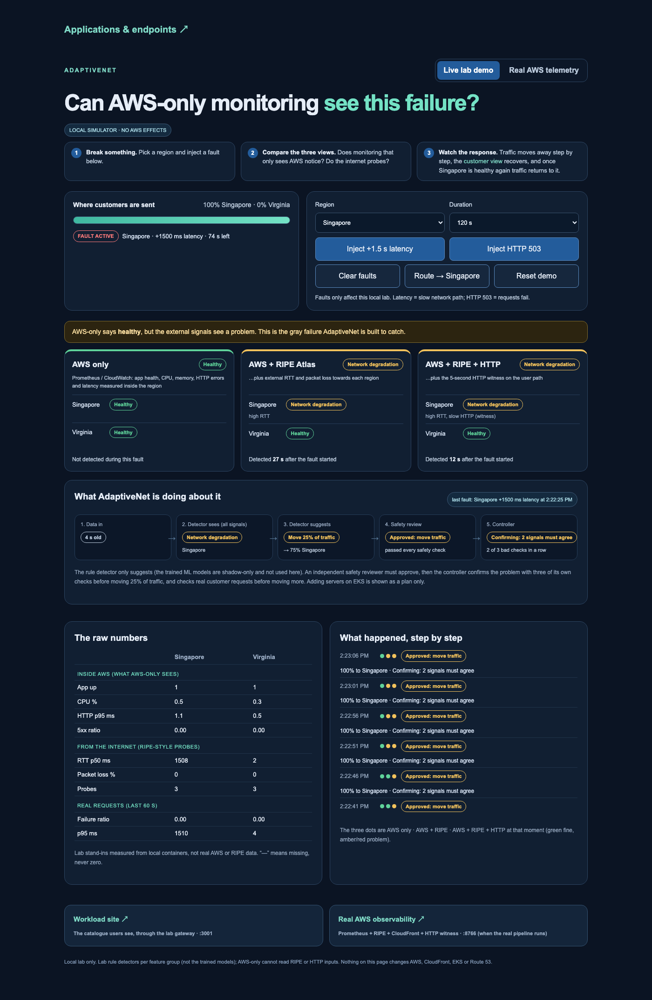

# AdaptiveNet: testing instructions

**Course:** CSC3104, Group 03\
**Repository:** https://github.com/Linus-Tay/adaptivenet, branch `main`\
**Time needed:** about 20–30 minutes, most of it waiting for the first Docker build

AdaptiveNet watches a two-region web service (Singapore `region-a`, Virginia `region-b`) from inside AWS and from the internet. It decides whether a region is degraded, and it moves traffic only after independent safety checks pass. These instructions let you run the whole loop on your own computer. **You do not need an AWS or RIPE Atlas account. Nothing in these steps contacts AWS.**

The steps are:

1. Install the tools (section 1).
2. Get the code and install the Python packages (section 2).
3. Run the automated tests (section 3).
4. Run the demo and break it on purpose (section 4).
5. Optional extra checks (section 5).

Each step shows the command to type and **what you should see**. Run every command from the repository root folder (`adaptivenet/`) unless the step says otherwise.

---

## 1. Install the tools

| Tool | Version we used | Needed for |
|---|---|---|
| Git | any recent | getting the code |
| Docker Desktop (macOS/Windows) or Docker Engine with Compose v2 (Linux) | Engine 29.9, Compose v2 | the demo (section 4) |
| Python | 3.11 or newer (we tested 3.12 and 3.14) | the tests and the fault command line |
| A web browser | any | the demo pages |

Node.js, Terraform, Helm and the AWS CLI are **not** needed for these instructions.

Check the tools:

```bash
git --version
docker --version
docker compose version
python3 --version
```

**Expected:** each command prints a version number. `python3 --version` must print 3.11 or higher. If `docker compose version` fails, install Docker Compose v2.

Start Docker Desktop and wait until it says it is running.

> **macOS:** if `docker` is "command not found" although Docker Desktop is installed, run
> `export PATH=/Applications/Docker.app/Contents/Resources/bin:$PATH`
>
> **Windows:** the scripts are bash scripts. Use WSL 2 (Ubuntu) with Docker Desktop's WSL integration turned on, and run every command inside the WSL terminal. *We have not tested Windows ourselves.*

**Ports.** The demo uses these local ports: 3000, 3001, 8000, 8001, 8080, 8101, 8102, 8190 and 8192. Close any program that uses them (for example a local LM Studio server on 8080).

---

## 2. Get the code and install the Python packages

### 2.1 Clone the repository

```bash
git clone https://github.com/Linus-Tay/adaptivenet.git
cd adaptivenet
git checkout main
```

**Expected:** `git checkout` prints `Already on 'main'`. `ls` shows folders such as `demo`, `services`, `ml`, `tests` and the file `README.md`.

### 2.2 Create a Python virtual environment

```bash
python3 -m venv .venv
source .venv/bin/activate
```

**Expected:** your prompt now starts with `(.venv)`. Keep this terminal open; later steps need the environment active. (If you open a new terminal, run `source .venv/bin/activate` again from the repository root.)

### 2.3 Install the packages

```bash
pip install -r requirements-dev.lock -r ml/team_starter/requirements-ml-inference.lock
pip install --no-deps -e .
```

**Expected:** the first command ends with `Successfully installed ...` listing packages such as `fastapi`, `pytest`, `scikit-learn`, `numpy` and `scipy`. The second ends with `Successfully installed adaptivenet-0.1.0`. A notice that a newer pip exists is harmless.

---

## 3. Run the automated tests

### 3.1 All test suites

```bash
PYTHONPATH=services:. python -m pytest -q tests demo/tests ml/team_starter/tests step7_finish step8_finish
```

**Expected:** after a few seconds the last line is

```
486 passed, 1 warning, 4 subtests passed in 3.49s
```

The time will differ. The one warning is a deprecation notice from a library and does not affect the result. **0 tests should fail.** None of these tests call AWS or the internet.

What the suites cover:

| Folder | Tests | What they check |
|---|---|---|
| `tests/` | 318 | data collection (AWS Prometheus, RIPE Atlas, CloudFront), SQS queue with outbox and dead-letter queue, feature snapshots, safety reviewer, confidence rules, safety controller, failover/failback/scaling, EKS HPA access (mocked) |
| `demo/tests/` | 16 | demo services, fault CLI, failback |
| `ml/team_starter/tests/` | 127 | datasets, training, evaluation, RIPE value study, shadow prediction |
| `step7_finish/`, `step8_finish/` | 25 | ML shadow inference service and final ML checks |

To run only the main suite: `PYTHONPATH=services:. python -m pytest -q tests` (expected: `318 passed`).

### 3.2 End-to-end smoke test without Docker

This starts every demo service as a local process and checks the main story end to end.

```bash
PYTHONPATH=services:. python -m demo.smoke_local
```

**Expected** (takes about 1 to 2 minutes; the numbers can differ slightly):

```
baseline healthy: {'aws_only': 'healthy', 'aws_ripe': 'healthy', 'aws_ripe_http': 'healthy'}
injected 700 ms path latency on region-a (external path only)
during fault: {'aws_only': 'healthy', 'aws_ripe': 'network_degradation', 'aws_ripe_http': 'network_degradation'}
decisions: 12, failover decisions: 7, gateway region-a weight: 75%
...
PASS: gray failure seen only with external signals; bounded failover applied on the local gateway
```

The important parts: AWS-only stays `healthy` during the fault, the two views with external signals report `network_degradation`, the gateway moves to 75% Singapore, and the last line starts with `PASS`.

### 3.3 Control-plane smoke test (also run in CI)

```bash
python scripts/smoke.py
```

**Expected:** some server log lines, then a last line of

```
PASS: auth, baseline, fault, healthy control plane, B routing, expiry, bounds, latency, cleanup
```

---

## 4. Run the demo and break it on purpose

The demo runs the full loop in local Docker containers:

```
local probes (stand-ins for AWS metrics, RIPE Atlas, HTTP witness)
  -> collector -> outbox -> queue -> feature worker -> snapshots
  -> rule detector -> proposal -> confidence rules
  -> independent safety reviewer -> decision
  -> safety controller moves traffic on the LOCAL gateway only
```

It uses no AWS calls and no credentials. The values are real measurements of local containers, labelled as lab data. The detector in this demo is a set of transparent threshold rules (`demo/lab/detectors.py`), not a trained model: the trained ML models are shadow-only, are not shipped in the repository, and never drive the controller.

### 4.1 Start the demo

Make sure Docker is running, then:

> **Linux only:** the containers run as a non-root user (uid 10001) and write to the `data/` folder. Run this once before starting, or some containers will restart in a loop with "Permission denied":
> ```bash
> mkdir -p data/lab-live data/demo-live data/demo-replay data/demo-models && chmod -R a+rwX data
> ```
> macOS and Windows (Docker Desktop) do not need this.

```bash
demo/run.sh lab-up
```

**Expected:** the first run builds the images, which takes several minutes. It ends with

```
Group lab: dashboard http://127.0.0.1:3000  site http://127.0.0.1:3001
Detector + safety decisions: http://127.0.0.1:8190
```

Check that all containers are up:

```bash
docker ps --format '{{.Names}}  {{.Status}}'
```

**Expected:** 13 containers whose names start with `adaptivenet-lab-` (for example `adaptivenet-lab-dashboard-1`, `adaptivenet-lab-gateway-1`, `adaptivenet-lab-lab-controller-1`), all showing `Up`. None should show `Restarting`.

### 4.2 Open the pages

Wait about 30 seconds after start-up, then open these in your browser:

| Address | What you should see |
|---|---|
| http://127.0.0.1:3000 | **Main demo page.** Title "Can AWS-only monitoring see this failure?", a "Where customers are sent" bar at **100% Singapore · 0% Virginia**, fault buttons, and three cards (AWS only, AWS + RIPE Atlas, AWS + RIPE + HTTP), all **Healthy** |
| http://127.0.0.1:3001 | The demo web site (product catalogue served through the gateway) |
| http://127.0.0.1:8190 | Raw decision-service view, for debugging |

On the main page, the "What AdaptiveNet is doing about it" row should read: Data in "a few s old", Detector sees **Healthy**, Detector suggests **Do nothing**, Safety review **No action**, Controller **Idle**.

### 4.3 Test 1: a network fault that AWS cannot see (the main test)

On http://127.0.0.1:3000:

1. Press **Reset demo** and wait about 30 seconds.
2. Leave **Region** on **Singapore** and **Duration** on **120 s**.
3. Press **Inject +1.5 s latency**.

This adds 1.5 seconds of delay on the network path to Singapore. The servers themselves stay perfectly healthy, which is exactly the kind of "gray failure" that monitoring inside AWS misses.

**Expected sequence** (times are from our run on 13 Nov 2026; yours may differ by some seconds):

| Time after pressing | What the page shows |
|---|---|
| 0 s | A red **FAULT ACTIVE** badge: "Singapore · +1500 ms latency" |
| about 10–15 s | **AWS + RIPE + HTTP** card turns to **Network degradation** (Singapore: "high RTT, slow HTTP"). Text under it: "Detected *N* s after the fault started" |
| about 20 s | **AWS + RIPE Atlas** card also shows **Network degradation** |
| the whole time | **AWS only** stays **Healthy** and says "Not detected during this fault". A yellow banner says "AWS-only says healthy, but the external signals see a problem." |
| about 20–60 s | Pipeline row: Detector suggests **Move 25% of traffic**, Safety review **Approved: move traffic**, Controller **Confirming** (it needs 2 of 3 signals to agree and then 3 checks of its own) |
| about 1 minute | Traffic bar moves to **75% Singapore · 25% Virginia** |
| about 2 minutes | If the fault is still active, a further step to **50% Singapore · 50% Virginia** |
| after the fault ends | The cards return to **Healthy**. Controller shows "Waiting: Singapore must stay healthy" |
| about 2–3 minutes after the fault ends | Traffic steps back: **75% Singapore**, then **100% Singapore · 0% Virginia** (failback). Controller returns to **Idle** |



In our run the full cycle (fault, two traffic steps, failback to 100%) took about 5 minutes. The "What happened, step by step" log on the right of the page records each decision with a time stamp.

**What this shows:** with the same telemetry, the view that uses only AWS-internal metrics cannot see a network-path fault, while the views that add internet probes detect it, and the system then moves traffic away in bounded 25-point steps and moves it back when the region is healthy again.

### 4.4 Test 2: an HTTP error fault

1. Press **Reset demo** and wait about 30 seconds.
2. Press **Inject HTTP 503** (Singapore, 120 s).

**Expected:** within about a minute, **AWS + RIPE Atlas** and **AWS + RIPE + HTTP** show **Network degradation** for Singapore, while **AWS only** stays **Healthy**. In this lab the 503 errors are injected on the gateway path that outside users take, so the servers' own metrics stay clean. Every probe to Singapore loses every packet here, so RIPE has loss but no RTT; the safety reviewer accepts that for the region traffic leaves. The pipeline row then shows Safety review **Approved: move traffic**, and the traffic bar moves to **75% Singapore · 25% Virginia** after about 40–45 s, to **50% · 50%** after about 75–85 s, and, if the fault is still active, to **25% · 75%** at about 115 s (our runs on 13 Nov). After the fault ends, the controller waits for Singapore to stay healthy and then moves traffic back in 25-point steps to **100% Singapore** (about 3 minutes after the fault ended in our run).

### 4.5 The same faults from the command line (optional)

With the virtual environment active, in the repository root:

```bash
set -a; source demo/.env.demo; set +a
PYTHONPATH=services:. python -m demo.faultctl lab-latency --region sg --ms 1500 --duration 120
```

**Expected:** JSON output containing `"status": "active"`, `"region": "region-a"` and `"latency_ms": 1500`. The main page then behaves as in section 4.3.

```bash
PYTHONPATH=services:. python -m demo.faultctl lab-errors --region sg --rate 1.0
```

**Expected:** JSON output with `"status": "active"` and `"error_rate": 1.0`.

(`demo/.env.demo` is created by `demo/run.sh` and holds only a random local token for the lab. It is not an AWS credential.)

### 4.6 Reset and stop

```bash
demo/run.sh lab-reset
```

**Expected:** Docker prints that the gateway and the lab controller were restarted. Traffic is back at 100% Singapore, all faults are cleared, and the controller's journal is emptied.

```bash
demo/run.sh lab-down
```

**Expected:** Docker prints `Removed` for each container and the network. `docker ps` then shows no `adaptivenet-lab-` containers.

---

## 5. Optional extra checks

### 5.1 Standalone stack with packet-loss faults

A second demo stack has its own emulated internet path, so it can inject packet loss, application errors and CPU load. Its page is the raw decision view only.

```bash
demo/run.sh up
```

Open http://127.0.0.1:8190. After 30–60 seconds all three feature-group rows read **healthy**. Then:

```bash
PYTHONPATH=services:. python -m demo.faultctl latency --region sg --ms 700
```

**Expected:** about 20–30 seconds later, `aws_ripe` and `aws_ripe_http` show `network_degradation` for region-a while `aws_only` stays `healthy`. Within about 2 minutes the gateway's region-a share drops (in our run it reached 50%). Other faults: `loss --region sg --pct 50`, `app-5xx --region us --rate 0.5`, `cpu --region sg`, `region-down --region sg`, and `status`. The table of expected outcomes for each is in `demo/DEMO.md`, section 2.

Reset with `demo/run.sh reset` and stop with `demo/run.sh down`. Run only one stack at a time; `lab-up` and `up` each stop the other.

### 5.2 Further reading

- `README.md`: overview, architecture, results table and safety rules.
- `demo/DEMO.md`: full demo guide, including replay of recorded real telemetry (needs the group's private data).
- `docs/END_TO_END.md`: decision path and confidence rules.
- `docs/ml/RIPE_CAMPAIGN_RESULTS.md`: the 20-trial packet-loss campaign on the real system.

---

## 6. Real AWS and RIPE Atlas parts

The real system runs on the group's AWS account (EC2 in Singapore and Virginia, CloudFront, Amazon Managed Prometheus, SQS, EKS) and uses the group's RIPE Atlas measurements. The repository contains **no credentials, keys or tokens**.

**AWS and RIPE Atlas access is held by the group. To test anything against the real cloud, please contact CSC3104 Group 03 and we will arrange access or a live demonstration.** None of the tests above need it.

**Optional: live AWS tests (group access needed).** On 13 Nov 2026 the group ran two live tests on the real AWS system; method, results, evidence files and limits are in `docs/LIVE_TESTS_20261113.md`:

- *CloudFront failover:* the Singapore service was stopped for 60 s. All 108 CloudFront requests returned HTTP 200; the 27 sent during the outage were served by Virginia, and traffic was back on Singapore about 90 s after the stop.
- *EKS scale-up:* a bounded load job on the Singapore cluster made the Kubernetes HPA scale from 2 to 4 pods in about 30 s, then back to 2 after the load ended.

In both tests AWS's own mechanisms (CloudFront origin failover, the Kubernetes HPA) acted, not the AdaptiveNet controller. These are single runs, and repeating them needs the group's AWS access.

---

## 7. Troubleshooting

| Problem | Fix |
|---|---|
| `docker: command not found` on macOS | `export PATH=/Applications/Docker.app/Contents/Resources/bin:$PATH` |
| `Cannot connect to the Docker daemon` | Start Docker Desktop (or `sudo systemctl start docker` on Linux) and wait until it is running |
| `port is already allocated` | Another program uses 3000, 3001, 8000, 8001, 8080, 8101, 8102, 8190 or 8192. Stop it, run `demo/run.sh lab-down`, then `demo/run.sh lab-up` again |
| Containers keep `Restarting`, logs show `Permission denied: '/app/data/...'` (Linux) | Run the `chmod` command in section 4.1, then `demo/run.sh lab-down` and `demo/run.sh lab-up` |
| `ModuleNotFoundError` when running tests | Activate the environment (`source .venv/bin/activate`), run from the repository root, and keep the `PYTHONPATH=services:.` prefix |
| Cards say "unknown" or "Data in" is old right after start | Wait 30–60 seconds for the first probe rounds |
| Demo seems stuck after many faults | `demo/run.sh lab-reset`, wait 30 seconds |

---

## Appendix: how we verified these instructions

On 13 Nov 2026 we followed these steps on a clean Linux machine (x86_64, Docker Engine 29.9.2, Compose 5.6.1, Python 3.12) with a fresh copy of `submission/final` (commit `2a886a4`; that work is now on `main`):

- Section 3: 472 passed, 0 failed (the 3 action-replay tests and 11 reviewer tests added later bring the total to 486); `demo.smoke_local` and `scripts/smoke.py` both printed PASS.
- Section 4: `lab-up` started all 13 containers; the latency test produced the sequence in 4.3 (HTTP view 11 s, RIPE view 21 s, 100→75% at about 65 s, 75→50% at about 120 s, back to 100% at about 286 s); the HTTP 503 test was detected by the two external views; `lab-reset` and `lab-down` worked.
- Section 5.1: the standalone stack detected the 700 ms latency fault in about 20 s and moved region-a to 50%.
- The group also ran `lab-up` on macOS with Docker Desktop.
- Re-check on `main` (commit `16645c0`, same machine, 13 Nov): 486 passed, 0 failed (318 in `tests/`); `lab-up` rebuilt and started; the HTTP 503 test (4.4) gave: both external views flagged Singapore within 5 s, safety review approved, traffic 100→75% at about 40 s, 75→50% at about 75 s, 50→25% at about 115 s, then back to 100% at about 306 s after injection (the fault ended at 120 s). AWS only stayed Healthy throughout.

Two notes from that run: on Linux the `data/` folder needed the `chmod` in section 4.1; and our test machine sat behind a network proxy, so we added its certificate to the image builds. A normal internet connection does not need that change.

Not tested by us: Windows (WSL 2).
