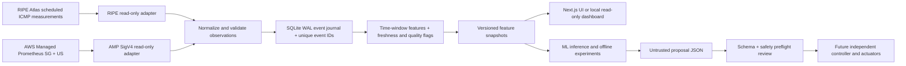

# AdaptiveNet — Ingestion, Feature Engineering & Team Handoff (v1)

## Scope and state

This overlay adds a **read-only, laptop-hosted ingestion and feature service**, NOT a cloud controller or production ingestion service. The two AWS Prometheus workspaces, EC2 exporters and RIPE Atlas measurements are external prerequisites that have already been deployed in the user's experiment. It does not create measurements, consume RIPE credits by scheduling new measurements, apply Terraform, change AWS, or enable actuation. **Polling AWS Managed Prometheus can incur query costs**, and the existing recurring RIPE measurements spend credits independent of whether this service runs.

The first experiment's RIPE measurement IDs are `222734302` (SG) and `222734303` (Virginia). They were configured to **stop 2026-10-14 13:21:22 UTC**; this viewer may have no fresh external observations after that. Historical raw observations already persisted locally can be used for training, but *never* be misrepresented as fresh live network data.

## End-to-end data flow

## Data-structure decisions (and why)

| Need | Structure | Complexity / correctness |
|---|---|---|
| Stable event idempotency | SHA-256 digest over observation identity, not poll time | O(1) primary-key lookup; repeated cached RIPE results are not counted twice |
| Durable observations | SQLite WAL event journal with B-tree composite index `(region, metric, observed_at DESC)` | Transactionally stores each successful poll; efficient region/time filtering |
| Real-time per-region signals | `dict[(region, metric)] -> list[Observation]` | Expected O(1) bucket lookup, independent from source JSON layout |
| Rolling windows | Bounded `deque(maxlen=120)` with time-key deduplication | Bounded memory, prevents repeated reads of the same AMP instant-vector timestamp |
| Probe summaries | `dict[probe_id] -> latest observation` | Ensures each probe has equal vote and no repeated RIPE cached result double-counts |
| Robust aggregations | Median, interpolated p95, EWMA; median absolute deviation | Safer against RTT spikes than an unbounded arithmetic average |
| Parallel network reads | Bounded `ThreadPoolExecutor`, static allowlisted endpoints | Isolates slow sources; never passes user/model-supplied URL or PromQL to subprocess |
| ML / controller boundary | Immutable versioned snapshot + explicit review result | Separates observed facts, inference, and authorization |

## Normalization contract

`Observation` fields:

- `region`: `region-a` or `region-b` (not inferred from target's IP).
- `source`: `aws_amp` or `ripe_atlas`.
- `metric`: fixed metric vocabulary, such as `app_up`, `http_p95_ms`, `network_rtt_ms`, `packet_loss_pct`, `memory_available_bytes`, `cpu_busy_pct`.
- `value`: finite floating-point value, with explicit `unit`.
- `observed_at`: time reported by the **source** in UTC Unix seconds.
- `collected_at`: local retrieval time in UTC Unix seconds.
- `source_id`: workspace or measurement/probe ID, avoiding customer identifiers.
- `event_id`: SHA256 derived from source identity + value + observed_at, *not* collected_at.

Never convert absent or stale data to zero. Zero packet loss means zero loss **was observed**; null packet loss means we have no trustworthy fresh observation. Empty AWS query vectors are `no_series`, not a proof of zero HTTP traffic.

## Feature snapshot v1

One snapshot is generated per poll; it contains `contract_version`, `snapshot_id`, `computed_at`, `computed_at_unix`, `pipeline_mode`, `ready_for_model`, `ready_for_automatic_action=false`, `quality_reasons`, two `regions`, `comparison`, and `source_errors`.

For each region:

| Feature | Unit | Meaning |
|---|---|---|
| `app_up` | boolean 0/1 | Instrumented demo self-reported up metric; absent if scrape/query unavailable |
| `http_rps` | requests/s | 5m rate of `/api/catalog` requests; requires observed traffic and >=2 counter samples |
| `http_5xx_rps` | requests/s | 5m rate of 5xx replies (missing if no error series exists) |
| `http_error_ratio` | proportion | 5xx throughput divided by all throughput *only when both are actually observed* |
| `http_p95_ms` | ms | HTTP catalog latency p95 from histogram buckets; not equal to ICMP RTT |
| `cpu_busy_pct` | % | CPU busy over rolling 5m, measured by Node Exporter |
| `memory_available_bytes`, `memory_available_pct` | bytes/% | Available host memory, checked against total |
| `node_load1` | load | One-minute load average |
| `network_rtt_p50_ms`, `network_rtt_p95_ms` | ms | Across distinct RIPE probes' median per-probe ping RTT |
| `packet_loss_pct` | % | Mean loss across distinct reporting probes |
| `ripe_probes_reporting` | integer | Distinct reporting probe count; quality minimum currently 3 |
| `cpu_busy_ewma_pct`, `http_p95_ewma_ms` | %/ms | Smoothing over at most 120 time-distinct samples in latest 10m |
| `http_p95_robust_z` | dimensionless | Robust anomaly signal; null with insufficient/non-varying baseline |

Cross-region comparisons use `region-a - region-b` sign convention; a negative latency delta means SG's observed RTT is lower than Virginia's **for those sampled probes**, not necessarily that SG is universally better. This comparison is sensitive to probe geography, population, temporal alignment and route. RIPE ICMP observations are not direct application latency or definitive proof of an AWS failure.

## Quality / temporal semantics

- Internal AMP samples expire after **180s**.
- Latest RIPE per-probe samples expire after **2100s**, tolerating its slower schedule and results cache.
- Probe quorum is **3 distinct fresh probes with RTT**, otherwise external quality isn't `fresh`.
- Every result includes per-signal timestamps and a quality reason. Missing/no-series, source timeout, expired measurements, and lagging probes remain visible.
- `ready_for_model=true` means both regions have minimum observed internal and external data; it is a **data quality gate only**, not permission to actuate.
- `ready_for_automatic_action` is **always false** in this overlay.
- A reviewed shift must use a snapshot no older than 180s, with explicit target region checks. Only a later authenticated controller may *consider* execution.

## ML team agreement

1. Read `GET /v1/features/latest` or export JSONL snapshots. Use `contract_version=adaptivenet.features.v1`; explicitly reject unknown major versions.
2. Split train/validation/test **chronologically**, never randomly shuffle adjacent windows. Multiple overlapping windows are correlated.
3. Only label faults from **controlled experiment manifests**: injected network delay vs application 5xx vs CPU stress vs normal. Never infer a ground-truth label from the same symptom feature you're training to predict.
4. Preserve NULL/missingness indicators rather than filling with zero. Distinguish unavailable sources from actual endpoint failure.
5. Produce `adaptivenet.proposal.v1` JSON with `snapshot_id`, `action`, `confidence`, optional `target_region_a_percent`, and a non-empty `evidence` list for traffic shifts. See `examples/model_proposal.example.json`.
6. Begin with a rule baseline (internal-only vs combined) before more complex ML; publish latency/false-positive/recovery metrics, not just accuracy.

## Controller team agreement

The model proposes; it never runs Terraform, Route 53 or Kubernetes directly. The existing `review` command rejects oversized weight changes, destination not healthy, unknown capacity, confidence below 0.8, missing evidence, stale snapshot, or schema mismatch. It **always sets** `approved_for_execution=false`, `executed=false` and `effective_action=hold`. Controller teammates must separately implement authenticated approval, independent real-time health checks, idempotency keys, cooldowns, rate limiting, current routing readback, rollback and audit logging. The present demo has `route53_enabled=false`; **no real DNS mitigation endpoint is wired yet**.

## Frontend team agreement

Use the versioned HTTP API, not direct RIPE/AWS calls from the browser. `GET /v1/features/latest`, `GET /v1/features/history?limit=50`, `GET /v1/ingestion/status` return JSON; the browser only connects to `127.0.0.1:8766`. Treat NULL as unavailable and respect timestamps. Expose `fresh`, `loss_only`, `insufficient_or_stale` clearly. Do not claim live network status after measurements stop.

## Deferred production tasks

Local SQLite on a Mac is a **development handoff**, not a highly available production transport. For deployment, move observation events to a durable regional queue/stream (SQS/Kinesis), consume with at-least-once delivery and event IDs for idempotency, store long-term time-series in PostgreSQL/Timescale or another suitable warehouse, persist schema versions, add backpressure and dead-letter queues, secure multi-tenant access and implement replayable experiment labels. The normalized event and feature contracts can remain unchanged.
